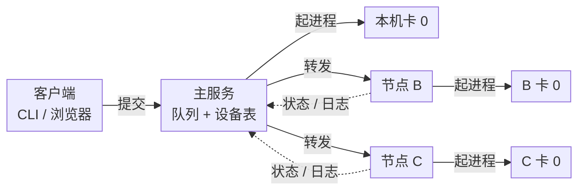
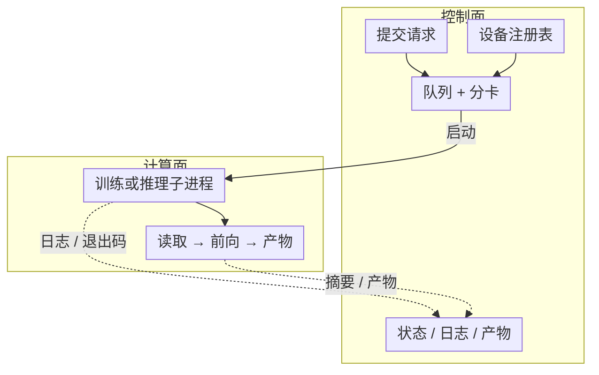
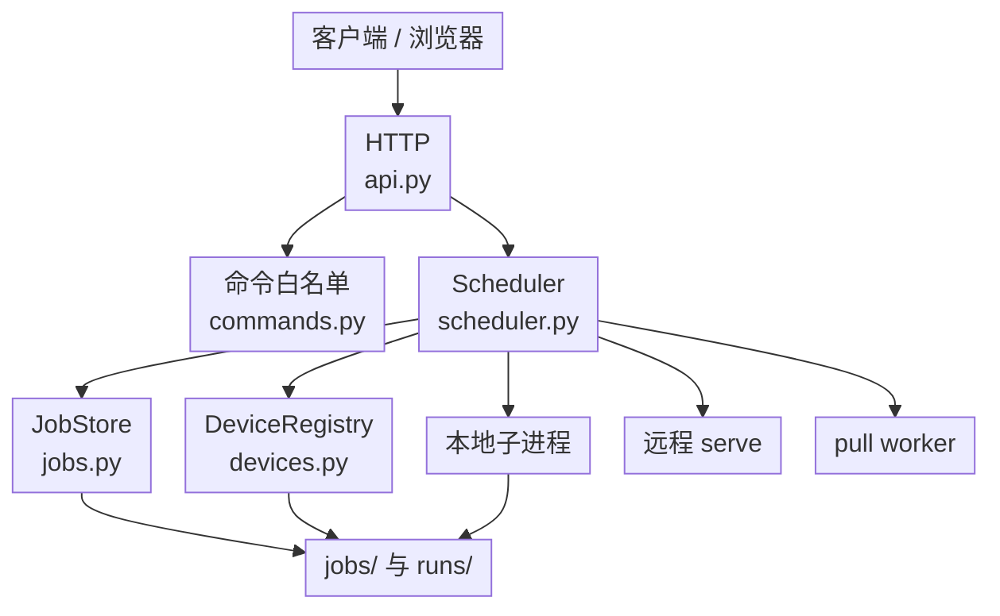
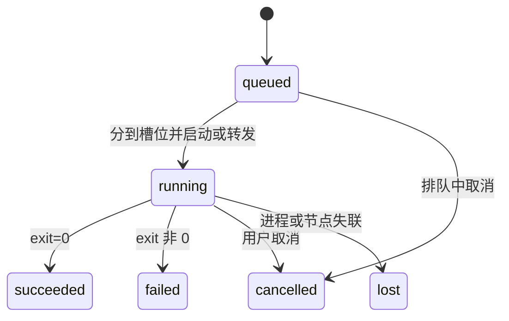
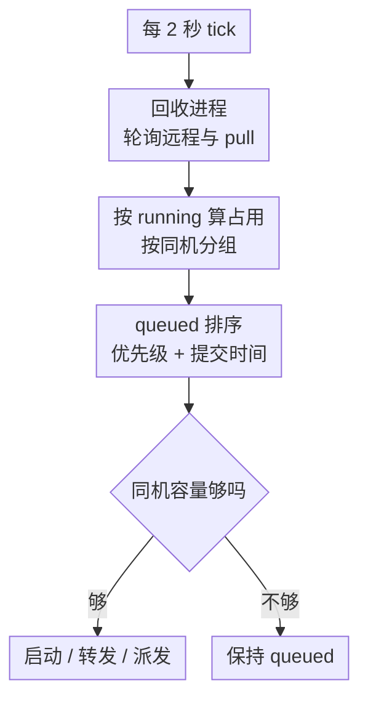
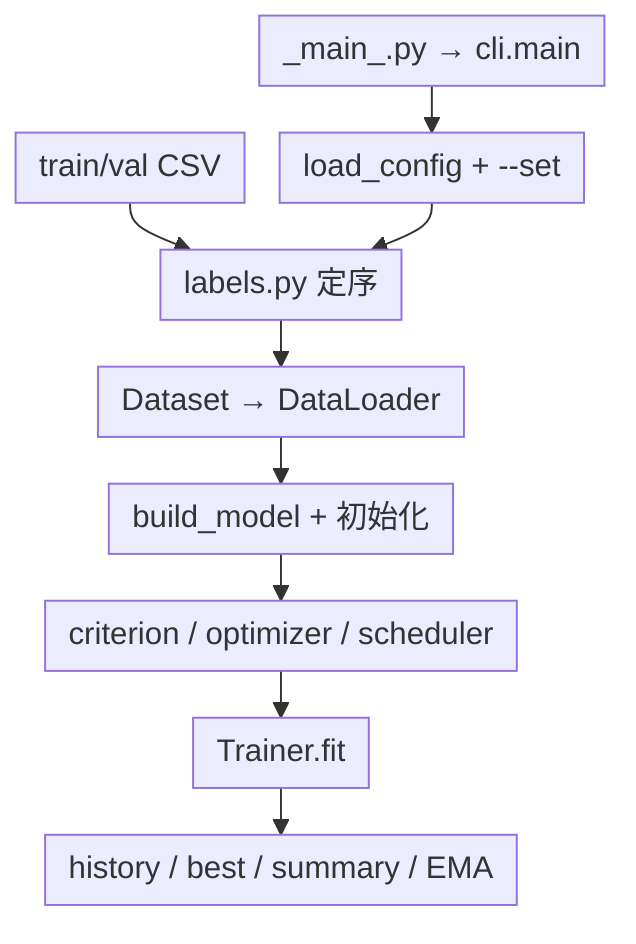
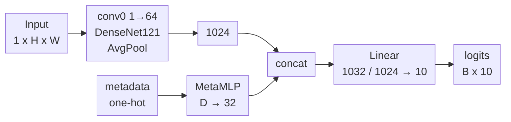
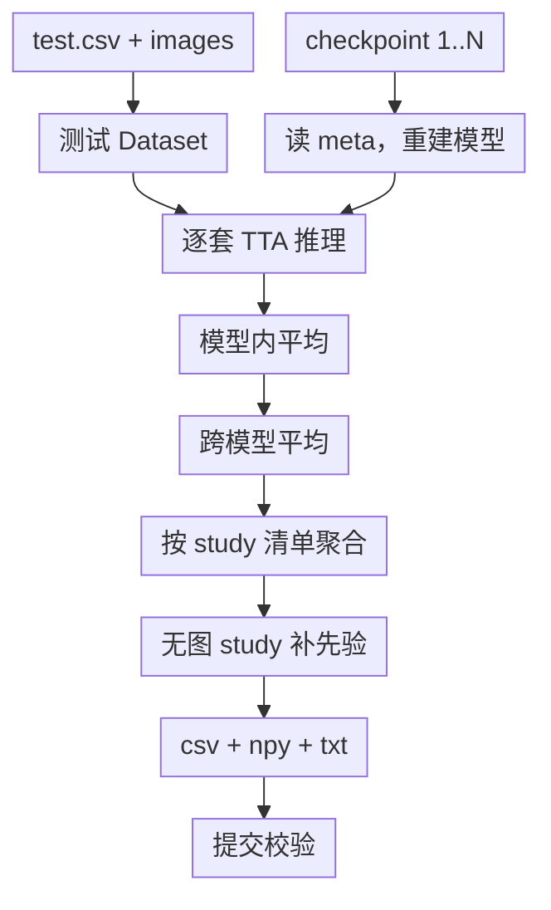
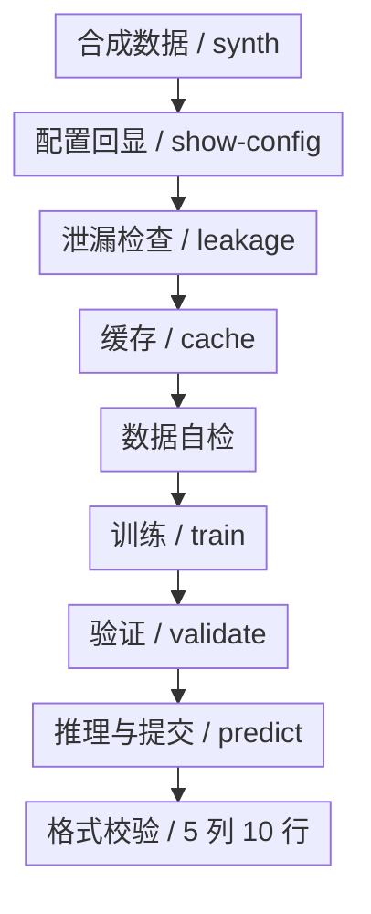

胸部 X 光，10 类多标签，主指标是 study 级 Macro-AUC。工程从空权重开始训，6.96M 参数全部自己初始化，没有加载预训练权重的入口。

下面按系统的层级往下走。先看整体由谁组成，再看请求怎么进来。之后是任务的排队、派发、执行和回收，训练子进程里从数据走到 checkpoint，最后落到一份提交文件。顺序按代码的实际形态排，不按目录排。

## 整体：谁在跑



客户端只提交任务。主服务拿着队列和设备表，可以在本机起进程，也可以把整单任务转发给另一台跑着 `serve` 的机器。节点在自己的卡上起训练进程，状态、日志、产物沿反方向回到主服务。

这里有三件事值得先说清。

主服务不训练。它接收、排队、选卡、启动或转发、回收结果，自己不碰一个 batch。

节点是完整的服务实例，有自己的队列、设备表和训练进程。它不做 GPU 透传。

任务向外走，结果向内走。控制流和结果流方向相反，这一点决定了后面所有接口的设计。

系统管什么、不管什么也划得很清楚。内部负责任务的提交、排队、分卡和进程启动；负责数据解析、训练、验证、推理和提交生成；也负责 checkpoint、日志、summary 与产物管理。外部交给主办方的数据、评测平台，以及容器、GPU、网络。不做的部分包括在线诊断服务、患者管理、多租户账号、跨机器分布式训练。

约束汇总：

| 项 | 约束 |
| --- | --- |
| 训练数据 | 只用主办方提供的那份 |
| 外部权重 | 没有加载入口，全部从零训练 |
| 样本粒度 | 训练按图像，标签、评估、提交按 study |
| 输出 | UTF-8 CSV，每个 study 出全部 10 类 |
| 模型体积 | 压缩前不超过 500 MB |
| 单图延迟 | 端到端不超过 100 ms |
| 并行范围 | 单机任务级并行，或单机多卡 DDP |

## 两个面



控制面回答谁可以跑、现在哪张卡空着、任务到了哪一步。计算面回答这批数据怎么训、模型输出什么、产物写到哪。

两个面用子进程边界隔开。调度器不 import 训练模型，也不在自己线程里执行训练。这条边界带来一个直接好处：主服务可以跑在一台没装 torch 的机器上，只负责派活。

角色分工：

| 角色 | 入口 | 职责 | 要数据吗 |
| --- | --- | --- | --- |
| 客户端 | `submit`、浏览器、curl | 提交、查状态、下产物 | 否 |
| 主服务 | `serve` | 队列、设备表、派发、回收 | 本机任务要 |
| 本地槽位 | 主服务拉起的子进程 | 在主服务机器上执行 | 是 |
| 推送节点 | 节点上的 `serve` | 收整单任务并本地执行 | 是 |
| 拉取 worker | `worker` | 主动注册、领任务、回传 | 是 |

多卡有两种，含义完全不同：

| 模式 | 调度单位 | 产物 | 用在哪 |
| --- | --- | --- | --- |
| 任务级并行 | 一个任务占一个槽位 | 多个独立 run | 多配方、多折、多模型集成 |
| 单任务多卡 | 一个任务占同机 N 个槽位 | 一个 run、一份 `best.pt` | DDP 训同一个模型 |

任务级并行拉高实验吞吐，DDP 拉高单个任务的算力。远程节点不能把多台机器拼成一个 DDP 世界，跨机只能各跑各的，之后合并概率。

拉取 worker 是拓扑上的补充。前两种都要求主服务能连到训练机，遇到 NAT、校园网隔离、训练机没有入站端口就不成立。worker 反过来主动连主服务，自己不暴露端口。

## 主服务内部



HTTP 层用标准库的 `ThreadingHTTPServer`，没引 FastAPI 也没引 Flask。它只管路由、JSON 编解码、token 鉴权、静态页面、请求体读取、异常转 400/404/500、文件下载和远程结果代理。业务逻辑不放在 handler 里，handler 只调 Scheduler、JobStore 和 DeviceRegistry。

客户端提交的 argv 不能随便拼。每个可提交的命令先登记，字段是 `name`、`group`、`config_kind`、`params`、`injects_run_name`、`artifacts`、`multi_gpu`。参数也要登记成 `Param`，字段是 `name`、`flag`、`kind`、`choices`、`path`。

校验规则七条：未登记的命令拒绝，未登记的参数字拒绝，参数不能以 `-` 开头，路径必须是项目内相对路径，路径不能含 `..`，整数小数枚举按声明校验，文本不能含换行。这套规则挡的是最坏情况：一个能从浏览器提交任意命令的服务，等于把机器交出去。

Scheduler 的输入是 queued 任务、设备注册表、每槽位当前占用、远程节点和 worker 的活跃状态。输出是本地子进程、远程 `POST /jobs`、待领取的 pull 任务、以及任务状态更新。

它不维护独立占用计数器。每次 tick 都从 running 任务重算占用，避免内存计数和落盘状态漂移。漂移的表现是两张卡被派了三个任务，症状是莫名 OOM。

JobStore 一任务一目录：

```text
jobs/
  <job_id>/
    job.json
    train.log
    files/          # pull worker 回传的产物
```

用文件不用数据库，理由有五条。任务规模只有几十到几百；状态变更不需要复杂事务；`job.json` 和日志能直接看；重启后能直接恢复；不用多运维一个数据库。

`job.json` 写到临时文件再 `os.replace()`，避免读到写了一半的 JSON。记录里放命令、配置、覆盖项、参数、run_name、优先级、备注、状态、pid、退出码、设备与远程回执、metrics、warnings、error、三个时间戳。

DeviceRegistry 落在 `jobs/devices.json`，支持三类槽位：

| 类型 | 示例 | 说明 |
| --- | --- | --- |
| local | `0`、`1`、`cpu`、`mps` | 主服务本机设备 |
| remote | `node-b:0` | 远程节点上的代理槽位 |
| pull | `laptop-a` | 一台主动拉任务的 worker |

字段有 id、kind、label、enabled、capacity、note、url、token、remote_device、last_seen 和最近一次 probe 结果。运行期可以增删、停用、探测，不用重启服务。

客户端协议只有 HTTP 加 JSON。`--set` 的值原样转发，客户端不做类型推断，真正的转换发生在训练侧的 `parse_overrides()`。`--param` 是命令参数，和配置覆盖是两回事。下载产物时按服务端返回的相对名建父目录。

## 任务的一生



六个状态的含义。`queued` 是已落盘、等同机槽位。`running` 是本地进程存在，或远程与 pull 节点已接收。`succeeded` 是正常退出，训练任务还要结合 `summary.json` 读。`failed` 是非零退出或启动失败。`cancelled` 是用户取消且已到终态。`lost` 是状态未知，不代表训练逻辑失败。

提交按固定顺序走：

1. 解析 command、config、overrides、params。
2. 查命令白名单。
3. 查参数是否合法。
4. 查配置路径是否在项目内。
5. 查 `--set` 的键是否存在。
6. 生成 job_id，检查 run_name 冲突。
7. 写 `job.json` 为 queued。
8. 调一次 `scheduler.tick()`，能派就进 running。

任何一步不过，回 400 并说清卡在哪。

run_name 冲突时会自动加 `_r2`、`_r3`。检查三处：有没有和活跃任务同名，有没有和历史任务同名，对应的 run 目录是否已经存在。三个理由。两个进程不能同时写同一个 `best.pt`；`train.resume=true` 会从旧 `last.pt` 接着训；如果旧 run 已经跑满 epoch，新任务可能一个 batch 都不跑就正常退出。

槽位选择每个 tick 都重算：



排序键是 `(-priority, created_at)`，同优先级先到先跑。本机槽位优先于远程，少一层网络故障面。

本地派发走 `Popen(shell=False, start_new_session=True)`，环境里注入 `CUDA_VISIBLE_DEVICES`。训练代码统一写 `device="cuda"`，让 PyTorch 只看得到分到的卡，某处漏传 `cuda:N` 也不会把两个任务挤到同一张卡。

远程派发有四条硬约束。两端同一份代码与配置；所需数据在远程本地；主服务只发相对项目根的配置路径；远程 token 目前明文存在主服务的 `devices.json` 里。

pull 的时序分三段。worker 先 `join`，拿到 device_id 和轮询间隔。之后循环 `poll`，收任务或取消标记。执行中 `log` 补日志，结束 `artifact` 传产物、`finish` 报终态。超过 30 秒没心跳就不再派新任务，超过 120 秒把运行中的任务标成 `lost`。

`gpus=N` 的任务占同主机分组里 N 个槽位，四个槽位同时计为 busy。凑不齐就整单排队，不拆到两台机器。`gpus=0` 表示把当前可用的同机槽位全给它。

取消分三种。本地排队任务直接改 cancelled；本地运行任务终止进程组，POSIX 上先 SIGTERM，等不到再 SIGKILL；远程任务由主服务向节点发取消请求，状态由节点回传；pull 任务只在主服务上置 `cancel_requested`，worker 下次 poll 取走再杀本机进程。

进程退出后读 `summary.json` 回填指标。产物有两份白名单：

```text
训练  summary.json  history.csv  config.yaml  train.log
      best.pt  best_ema.pt  ema.pt  kfold_summary.json
推理  submissions/*.csv  *_study_probs.npy  *_studies.txt
```

下载接口对两份白名单和路径穿越都做检查，主服务不读任意路径。

## 训练流水线



配置继承的优先级是：父配置低于 `_gear_`，`_gear_` 低于当前 YAML，当前 YAML 低于 `--set`。相对路径统一锚到项目根，从任何工作目录启动都指向同一份数据和产物。

单折训练的步骤是固定的：

1. 设种子，解析实际设备。
2. 建 `runs/<run_name>/`，把最终配置存成 `config.yaml`。
3. 读 train 标签表，用 train 的 class id 顺序读 val 标签表。
4. 在 train 上拟合元数据词表。
5. 建 Dataset 和 DataLoader。
6. 算每类正例数和 pos_weight。
7. 建模型并做从零初始化。
8. 设 head bias 与 head weight。
9. 建 AdamW 和 warmup 加 cosine 的 scheduler。
10. 可选恢复 `last.pt`。
11. 跑 epoch。
12. 保存 best、last、EMA、history 和 summary。

一个 epoch 里依次做：

- `model.train`，施加主干冻结。
- 推进 `DistributedSampler.set_epoch`，取 batch。
- 按概率决定做不做 MixUp 或 CutMix。
- autocast 前向，算损失。
- 反向并累积梯度，裁剪，`optimizer.step`，`scheduler.step`。
- `EMA.update`。
- 切 `model.eval` 验证，跨 rank gather，聚合到 study 级，算 Macro-AUC 和 F1。

K 折把官方 train 和 val 合并，按 `Subject_id` 做 GroupKFold，每折一套 `best.pt`，最后汇总成 `kfold_summary.json`。目录是 `runs/<run_name>_kfold/fold0..4/`。每折强制 `resume=false`，避免从折目录里的旧权重续训。

checkpoint 的逻辑结构：

```text
{
  "meta": {
    "format": "csd-checkpoint-v1",
    "model": {...},
    "transform": {...},
    "num_classes": 10,
    "input_mode": "conv1",
    "class_ids": [1..10],
    "class_names": {...},
    "metadata_vocab": {...},
    "study_agg": "mean",
    "fold": int|null,
    "seed": int
  },
  "epoch": int,
  "metrics": {...},
  "ema_applied": bool,
  "model": state_dict,
  "optimizer": optional,
  "scheduler": optional,
  "ema": optional
}
```

三条设计目标：不 pickle 整个模型对象；推理只依赖项目代码和 state_dict；meta 足以重建模型结构、输入模式、类别顺序和元数据词表。

现状有一条要说清：`load_checkpoint()` 还在用 `weights_only=False`。测试验证过 payload 可以用 `weights_only=True` 读，生产加载没切过去。

EMA 对浮点 state_dict 做滑动平均，包括 BatchNorm 的 running stats。公式是 `shadow = decay * shadow + (1-decay) * current`，前 100 次更新用更保守的动态 decay。训练结束后，EMA 指标比普通 best 好就写 `best_ema.pt`；无论是否胜出，都写 `ema.pt` 供集成用。推理默认优先 `best_ema.pt`，回退 `best.pt`。

续训从 `last.pt` 恢复模型权重、optimizer、scheduler 和下一个 epoch 编号。checkpoint 的 epoch 已经达到目标时，训练循环不执行任何 batch 但进程正常退出，靠 `summary.json` 的 `epochs_ran=0` 识别空转。当前续训没有恢复 EMA 的历史状态。

DDP 先由父进程读同一份配置，`plan()` 决定 nprocs。等于 1 就当前进程直接训。大于 1 就起 N 个子进程，各自 `init_process_group`，包 `DistributedDataParallel`。各 rank 训不同 batch，梯度 all-reduce，rank0 写文件。

规则有六条：所有 rank 的模型初始化必须一致；构建模型之后再给 rank>0 错开种子；`DistributedSampler` 每 epoch 调 `set_epoch()`；验证概率用 `all_gather_object` 跨 rank 汇总；checkpoint 和 EMA 都针对裸模型，不带 `module.` 前缀；只有 rank0 写文件。

## 数据与模型

数据粒度转换是这条链：

```text
CSV 一行一图
  -> 按 Study_id 聚合标签并集
  -> study 级标签矩阵
  -> 标签复制回每张图
  -> Dataset 一行一图
  -> 验证和推理再聚合回 study
```

CSV 和 ID 有几条硬规则。所有表以 `dtype=str` 读，`Study_id` 的零填充不能丢。class id 固定 1 起始、范围 1 到 10，val 和 test 必须复用 train 的顺序。缺类别时不能压缩列号。

标签支持 `1;3;7`、`1,3,7`、`1|3|7` 三种分隔，也支持一行一个类别，按 study 分组后取并集，最终是 `(num_studies, 10)` 的 float32 矩阵。

图像路径按顺序找：先看 `cache_dir` 下的直接路径，补扩展名，再看 `image_dir` 下的直接路径，补扩展名，最后按文件名递归搜索。都找不到就抛明确的 `FileNotFoundError`，不返回空图。图像统一转成 8 位灰度 PIL 图。缓存模式把短边缩到 512 左右存 PNG，训练时再从缓存图裁到目标分辨率。

泄漏检查比两个集合：train 和 val 的 `Study_id` 有没有重叠，`Subject_id` 有没有重叠。同一患者跨 split 会让验证分数虚高，K 折必须按 `Subject_id` 分组。

训练变换的顺序：

1. Grayscale
2. RandomResizedCrop
3. RandomHorizontalFlip
4. RandomRotation
5. RandomAffine 平移
6. ColorJitter
7. ToDtype
8. RandomErasing
9. 可选的 RepeatChannels
10. Normalize

默认 `conv1` 走单通道，归一化 `(0.5, 0.5)`，把 `[0,1]` 映射到 `[-1,1]`。`repeat3` 只作对照。

验证和 TTA 走 Resize 短边、CenterCrop，再按分支做 identity、hflip、scale 或 rotate，最后归一化。TTA 必须确定性，多个分支先在概率空间平均。

MixUp 和 CutMix 在 Trainer 里做，抽到就混合图像和标签，CutMix 用矩形粘贴并按面积重算 lambda。多标签的正负元素用同一个 lambda。开了元数据就跳过混合，因为类别字段没法按 lambda 插值。



模型默认 6.96M 参数，fp32 约 26.6 MB。输出永远是 logits，不接 sigmoid。

初始化按四步走：卷积用 Kaiming 正态、fan_out；BN 的 gamma 设 1、beta 设 0；线性层用 Xavier；head bias 设 `log(p/(1-p))`，head weight 设 0。结果是初始分类头变成按类别先验猜的常数预测器，第一步主干没有梯度，第二步恢复。

DropPath 训练时按样本生成 mask，`output = output / keep * mask`，推理时原样输出。mask 按样本生成，效果接近随机深度；逐元素丢弃那种是 Dropout，两者不一样。默认按密集层层深线性增大丢弃率，实现不改变 state_dict 键名。

损失四种：

| 损失 | 特点 |
| --- | --- |
| `bce` | 最稳定的基线 |
| `bce_posw` | 默认，按每类正负比加权，cap 20 |
| `focal` | 压低简单样本 |
| `asl` | 正负不同 gamma，并平移负样本概率 |

标签平滑是 `y' = y * (1 - epsilon) + epsilon / 2`，pos_weight 是负样本数除以正样本数，带最大截断。

优化器把参数按 head、backbone 和 decay、no_decay 切成最多四组。1 维参数和所有 bias 默认不吃 weight decay，包括 BatchNorm 的 scale 和 shift。衰减是解耦的，对 BN 的尺度参数做衰减等于把它往 0 拽。

## 评估、推理、提交

图像到 study 有三种聚合。`mean` 是概率算术平均；`logit_mean` 先平均 logit 再 sigmoid；`max` 逐类取最大。

study 清单是权威顺序。输出严格等于清单，清单外的 study 告警并忽略，清单内没有图的 study 先填 0.5，推理时可以用训练集先验覆盖。

Macro-AUC 逐类算 ROC-AUC。某类只有一种标签时返回 NaN，只对有效类取平均，同时记录 `skipped_classes`。Macro-F1 用阈值二值化，是辅助指标，不参与主排序。



验证和提交共用同一条 predictor 路径，本地指标和线上提交不会分叉。

提交固定五列：

| 字段 | 约束 |
| --- | --- |
| `Subject_id` | 必填字符串 |
| `Study_id` | 必填字符串，保留零填充 |
| `Predict_class` | 合法 class id，每个 study 出满 10 行 |
| `Probability` | `[0,1]` |
| `Gate` | 空或 `[0,1]`，空表示官方默认阈值 0.5 |

写出有四道保护。轻微越界的概率裁到 `[0,1]`；越界幅度超过 1.0 判为 logits 误传；临时文件写完原子替换；同一 study 只能对应一个 subject。

集成在概率层做。N 个模型各自带 TTA 出概率矩阵，等权或加权平均，再按 study 聚合。离线也有合并路径：`<stem>_study_probs.npy` 配 `<stem>_studies.txt`，按 study 名称对齐，不假设行号顺序。

## 横切：配置、存储、安全、部署

配置由 dataclass 定义，YAML 只提供值。`--set` 的未知键立即报错，YAML 的未知键告警后忽略。加载完做类型和语义校验，再把相对路径锚到项目根，同时把生效配置存成 `config.yaml` 留痕。

存储布局：

```text
项目根/
  runs/<run_name>/     best.pt, last.pt, best_ema.pt, ema.pt,
                       history.csv, summary.json, config.yaml, train.log
  submissions/         *.csv, *_study_probs.npy, *_studies.txt
  jobs/<job_id>/       job.json, train.log, files/
  jobs/devices.json
  cache/               预缩放图
  data/                数据集
```

关键文件各管一件事：

| 文件 | 作用 |
| --- | --- |
| `summary.json` | 判断训练是否完成、结果如何 |
| `history.csv` | 每 epoch 的指标曲线 |
| `job.json` | 任务状态与调度信息 |
| `best.pt` | 普通最优权重 |
| `best_ema.pt` | EMA 最优权重 |
| `ema.pt` | 集成可选的 EMA 权重 |

安全做了六件事：命令白名单、参数白名单、路径锁在项目内、`shell=False`、产物下载路径检查、可选 Bearer token。

也仅到内网级别。没有角色和任务所有权，token 是共享的长期密钥，远程 token 明文落盘，没有 TLS、限流和审计。对外暴露必须套反向代理和访问控制。

日志要能回答七件事：实际用的是哪个设备；训练多少图、多少 study；每类正例数和 pos_weight；损失和初始化有没有真的生效；每 epoch 的 train/val loss、Macro-AUC、F1、lr；DDP 的 world size 和全局 batch；任务最后是完成、失败还是 lost。

目标环境是 Python 3.12、torch 2.10.0、torchvision 0.25.0、CUDA 12.8 加 cuDNN 9。四种启动方式：

```text
主服务      python _main_.py serve --devices 0,1,2,3
客户端      python _main_.py submit --server http://10.0.0.8:8765 ...
远程节点    python _main_.py serve --devices 0,1 --port 8765
拉取 worker python _main_.py worker --server http://10.0.0.8:8765
```

## 接口

| 方法 | 路径 | 作用 |
| --- | --- | --- |
| GET | `/` | 网页控制台 |
| GET | `/health` | 服务、设备和队列快照 |
| GET | `/server` | 服务配置摘要 |
| GET | `/commands` | 命令与参数定义 |
| GET | `/configs` | train 与 infer 配置 |
| GET | `/datasets` | 数据集扫描 |
| GET/POST/PATCH/DELETE | `/devices[...]` | 设备槽位的增删改查与探测 |
| GET | `/jobs` | 任务列表 |
| POST | `/jobs` | 提交任务 |
| GET | `/jobs/<id>` | 任务详情 |
| POST | `/jobs/<id>/rerun` | 重跑 |
| GET | `/jobs/<id>/log` | 日志 |
| GET | `/jobs/<id>/artifacts[/name]` | 产物清单与下载 |
| DELETE | `/jobs/<id>` | 取消 |
| GET | `/env/doctor`、`/env/config` | 环境检查、生效配置 |

pull worker 五个接口：

- `/pull/join` 注册。
- `/pull/poll` 心跳、领任务、查取消。
- `/pull/log` 回传日志。
- `/pull/finish` 回传终态。
- `/pull/artifact` 回传产物。

提交一个训练任务的请求体长这样：

```json
{
  "command": "train",
  "config": "configs/train/highres.yaml",
  "overrides": {
    "train.epochs": "24",
    "train.run_name": "hr320"
  },
  "params": { "gpus": "4" },
  "priority": 10,
  "note": "320 baseline"
}
```

## 测试



合成数据把类别信息画进图像的固定位置。Macro-AUC 接近 0.5 通常说明数据、标签或聚合链路错位了。

测试覆盖十块：配置继承、覆盖和校验；标签解析与类别映射；Dataset 和图像缓存；初始化、head 先验、冻结、DropPath；损失、MixUp 与 CutMix、优化器分组；checkpoint、EMA、快照剪枝；DDP 的 sampler、跨 rank 汇总和槽位记账；指标、聚合、概率合并；提交格式和路径安全；本地与远程调度、HTTP、pull worker。

2026-10-28 在 Windows、Python 3.12.10、torch 2.10.0+cu128、torchvision 0.25.0+cu128 上收集 382 项，通过 379 项，失败 3 项。失败集中在平台相关路径：Windows 匿名管道的 `select()`、Windows 的取消与进程组、当前 CUDA/NCCL/gloo 与主机名环境下的 DDP 自测。同一份测试在本机 macOS 上 382 项全过，差异只在这些平台分支。

正式交付前要在目标 Linux 和比赛容器里重跑完整测试与九步冒烟。

## 已知问题

1. `load_checkpoint()` 仍用 `weights_only=False`。
2. 多模型预测只从第一个 checkpoint 读 class_ids，没有逐模型强校验。
3. 离线概率合并脚本对官方原始列名的兼容性还没统一。
4. pull worker 的推理产物用最近一小时的时间窗过滤。
5. Windows 的管道、进程组和 DDP 环境与 POSIX 不完全一致。
6. TensorBoard、折后全量训练和边缘裁剪字段还没接线。
7. 续训没有恢复 EMA 的历史状态。
8. 安全模型只适用于可信内网。

明确不做的包括多机 DDP、跨主机 NCCL、OOM 自动降 batch 重试、用户权限隔离、中央数据库与跨主服务统一队列、在线诊断 API。

这份规格按提交 `5fd4225` 核对，代码再动就要跟着改。
