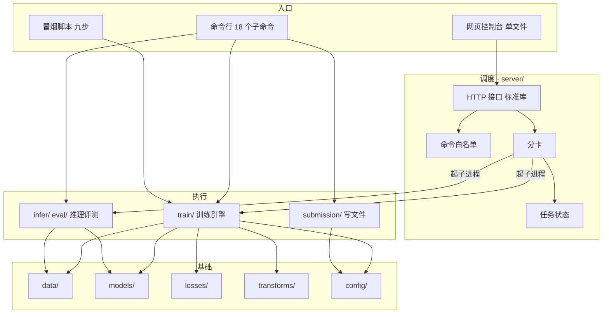
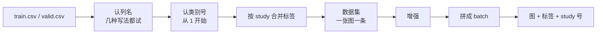
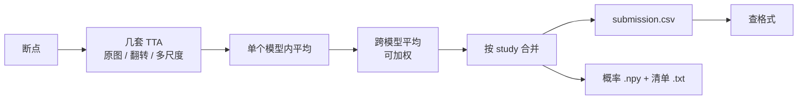
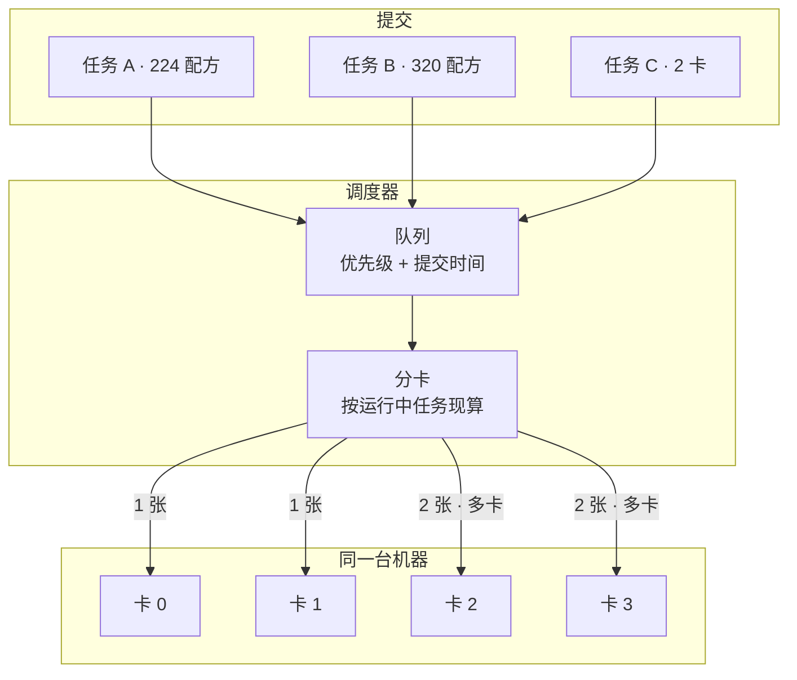
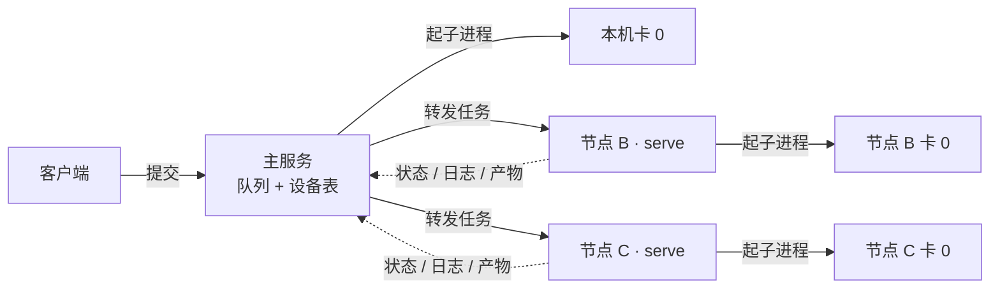
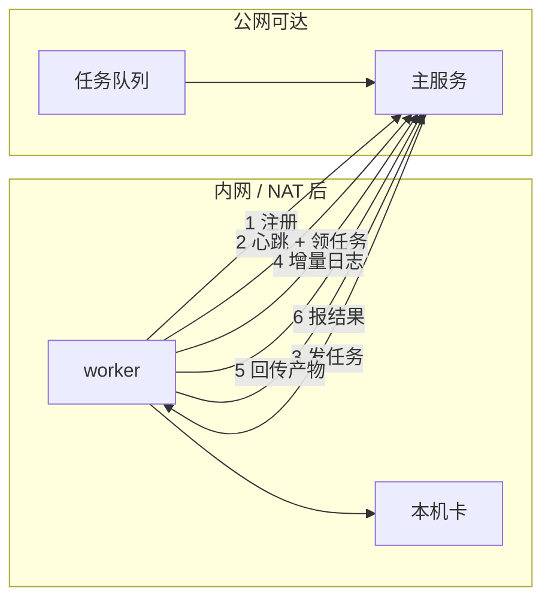

胸部 X 光，10 类多标签。一张图可以同时有几个征象，也可以一个都没有。数据按 study 组织，一个 study 底下可能挂着几张不同体位的图，提交却按 study 算。

比赛只让用主办方给的数据。我把这条往前推了一步，预训练权重也不用。DenseNet121 从 `weights=None` 起，6.96M 参数全部自己初始化。

没有预训练权重，能靠的就剩三样：初始化怎么写、正则怎么加、训得够不够久。下面讲这三样怎么落进代码，以及为了同时跑几十组实验，我在外面又套了什么。

## 起点：三条约束

Macro-AUC 是主指标，每个类等权。稀有类正例可能只有个位数，掉一点就拖整体。损失得给稀有类加权，但要设上限；不设的话一个 batch 就能把训练带崩。

提交按 study，每个 study 必须出满 10 行，缺一行就是格式错。所以训练看单张图，评测和推理按 study 合并，类别顺序从训练一路钉到提交。

数据只用主办方给的那份，不并外部标注，不加载预训练权重。这条把「通用视觉特征」这条路堵死了，剩下能调的就是初始化、正则和 schedule。

还有个容易忽略的点：Macro-AUC 只看排序。调阈值让 F1 好看，AUC 一点不动。工程里 `submission.threshold` 只影响写进文件的 Gate 列，不参与选模型。

## 代码怎么切

11 个包，13.5k 行 Python，外加 2.6k 行写在 HTML 里的前端。

| 包 | 行数 | 职责 |
| --- | --- | --- |
| `config/` | 866 | 配置 schema、继承合并、设备解析 |
| `data/` | 1543 | 标签表、数据集、study 合并、泄漏检查 |
| `models/` | 779 | DenseNet121、初始化、DropPath |
| `losses/` | 401 | 四种损失 |
| `transforms/` | 263 | 增强与 TTA |
| `train/` | 2334 | 训练循环、优化器、EMA、DDP、断点 |
| `eval/` | 322 | 指标与评测入口 |
| `infer/` | 749 | 推理、集成、概率合并 |
| `submission/` | 337 | 写文件、查格式 |
| `server/` | 4528 | 排队、分卡、HTTP、网页 |
| `utils/` | 286 | 读图、随机种子 |

调用只朝一个方向走：入口调执行，执行调基础，反向一条都没有。

训练代码不知道自己被谁拉起来。同一个 `run_training`，命令行能直接调，调度器能当子进程拉，`torchrun` 能拉成 N 个进程。判据全在环境变量里，代码里没有开关。

推理也不看训练配置。预处理参数、类别顺序、分辨率都从断点文件的 meta 里读。224 训出来的模型和 320 训出来的模型，能塞进同一个集成，各自按自己的尺寸处理。

调度层碰不到训练细节。`server/` 里没有一行 import `torch`，它只管拼命令、分卡、收产物。所以调度服务能跑在一台没装 torch 的机器上。

## 参数放哪

配置是唯一的参数来源，代码里没有写死的数字。

继承分三层。`base.yaml` 放公共默认值，`gear/*.yaml` 只管和机器有关的那几项，`train/*` 和 `infer/*` 是具体配方，用 `_base_` 指向上一层。合并是递归的，带环检测。相对路径按引用它的那个文件所在目录算。所有路径最后都锚到项目根，从哪个目录启动，产物都落同一处。

命令行覆盖和 YAML 的严格度不一样，这是故意的。`--set train.epochz=30` 当场报错，还带拼写建议，因为人在敲命令，立刻纠正最省时间。YAML 里写错键只提醒一声，因为那份 YAML 可能是继承链上别人写的，直接失败会卡住一整条链。

加载时一次把能查的都查了：类别数三处是否一致、通道数和第一层卷积是否对得上、`drop_path` 和 `label_smoothing` 是否越界、随机裁剪的上下界是否颠倒、DDP 要的卡数够不够。有问题的在开跑前就拒绝，不等 30 个 epoch 跑完才发现参数没生效。

几个默认值是我特意定的：

- 随机裁剪 scale 0.70~1.0，ratio 0.90~1.12。胸廓比例固定，不该像自然图像那样抖到 3:4；下界再往下压，会把要判别的结构本身裁掉。
- 归一化用 `(0.5, 0.5, 0.5)`。不用别人的权重，就没理由沿用别人的统计量。
- `drop_path`、`mixup_p`、`label_smoothing` 默认全关。这三个强度得按数据量调，`scratch_strong.yaml` 里才一起打开。
- `train.resume: true`。断点续训是默认行为，所以换实验必须换 `run_name`，否则会接着旧断点往下跑，两次结果不可比。

机器档位只差三项：

| 档位 | workers | 混合精度 | 编译 | 用在哪 |
| --- | --- | --- | --- | --- |
| `mps_tiny` | 0 | 关 | 关 | 本机 Apple Silicon |
| `cuda_full` | 8 | bf16 | 关 | 比赛的单卡 |
| `cuda_ensemble` | 8 | bf16 | 开 | 集成阶段 |

MPS 的限制是硬的：不能多进程取数，没有混合精度，不能编译。这些不在每个配方里重写一遍，统一在 `config/devices.py` 里按设备类型钳住。换机器改一行就够。

## 数据这一层

列号按类别号定位，不重新编号。一批数据只出现 5 个类时，内部压成 5 列，训练和提交的列序就分叉了。所以训练定死顺序，验证和推理必须显式传 `class_ids`，不靠猜。

类别号写成 1 起始。官方是 1..10。自动推断在数值重合时会出歧义，不值得赌。

标签按 study 合并。一个 study 几张图，任一张报了这个征象，整个 study 就算有。训练用单图标签，评测和推理用 study 标签。

合并有三种算法，差别只在哪一步取平均。`mean` 直接平均概率，默认用它，图质量差不多时最稳。`logit_mean` 先转 logit 再平均，概率贴着 0 或 1 时能躲开单张极端图的拉扯。`max` 取最大，只在「任一张有就算有」的语义下成立，结果会系统性偏高。

study 清单是准的。合并结果严格等于传进去的清单。清单外多出来的预测忽略并提醒，清单里没有图的 study 填先验值。少了这条，提交缺行要等上传完才发现。

患者泄漏要先查。训练集和验证集按患者分，同一个人的图不能两边都有。官方切分如果在患者级别不干净，本地分数会虚高，早停会停在错的位置，而这个错在提交前看不出来。K 折同理，按患者分，不按 study 分。

## 模型

骨干是 torchvision 的 DenseNet121，改了三处。

第一层卷积从 3 通道改成 1 通道，灰度图直接进。没有预训练权重，就没必要复制成 3 通道去凑别人的输入格式，`repeat3` 只留作对照。

池化从固定 7×7 换成自适应到 1×1，224、320、448 同一份代码都能跑。

分类头从 1000 类改成 10 类，`head_hidden=0` 时就是一层线性。

输出是 10 个 logits，不接 sigmoid。sigmoid 在损失和推理里各做一次，模型只负责吐原始分数。

实测 6.96M 参数，fp32 26.5 MB，离 500MB 上限很远。本机 CPU 单张前向，224 输入 30.9 ms，320 输入 49.0 ms。CPU 的数字不能当 T4 的延迟，不过这个规模不太可能卡在速度上。

### 初始化

从零训练时，初始化是唯一能免费塞进先验的地方。

卷积和线性层用 Kaiming 正态，按 fan_out 算。每个卷积后面都跟 BN。这个版本比 PyTorch 默认的 `kaiming_uniform(a=√5)` 更合适。BN 的权重设 1、偏置设 0。

分类头权重设 0，偏置设成 `log(p/(1-p))`，p 是这个类在训练集里出现的比例，再夹到 ±6.0。两件事合起来，训练第 0 步模型输出就是「按类别比例猜」。不花钱，但省掉开局把偏置推到位的几十步梯度。

夹到 ±6.0 是为了极端不平衡。某类频率如果是万分之一，`log(p/(1-p))` 会到 -9.2，配上零权重，这部分梯度会长期卡在很小的值里。

### 随机深度

速率按层深线性铺开，第一层不丢，最后一层丢到设定值。

实现上把它挂成 `_DenseLayer` 的子模块。只留 hook 闭包不行：`.eval()` 传不到它，推理时还在随机丢分支。同一张图两次预测不一样，而且不报错。挂成子模块之后，断点里的键名不变，开关它不会让旧断点失效。

### 损失

四种，同一个接口，共用标签平滑。

| 类型 | 做法 | 参数 |
| --- | --- | --- |
| `bce` | 标准二元交叉熵 | 无 |
| `bce_posw` | 交叉熵乘逐类正样本权重 | 权重为负/正，夹在 `[1e-3, 20]` |
| `focal` | 难样本加权 | γ = 2.0 |
| `asl` | 正负样本不同 γ，负样本概率先平移 | γ_pos=0、γ_neg=4、clip=0.05 |

标签平滑把目标从 1 改成 1-ε/2。官方标签来自报告里的「正面提及」，漏标比误标常见，软一点更贴合这种噪声。

正样本权重必须设上限。稀有类的正例可能只有个位数，负/正会到几百，不夹住的话一个 batch 就能把训练带崩。

ASL 和正样本权重同时开，正类等于被加权两次。所以 `scratch_strong.yaml` 把上限从 20 降到 10。真出现稀有类变差，第一步是把正样本权重整个关掉，用纯 ASL。

另有一层 `loss.class_weights`，按类别号给每类一个乘数。内部归一化到均值 1，免得整体 loss 尺度跟着变。这层是给「某几类一直上不去」精修用的，不当常规手段。

### 增强

只用 `torchvision.transforms.v2`，不引 albumentations。少一个依赖，离线环境少一类问题。

顺序固定：转单通道，随机裁剪并缩放到目标尺寸，水平翻转 0.5，旋转 ±10°，平移 0.05，亮度对比度抖动各 0.2，转 float，随机擦除 0.1，归一化。

不做色相饱和度，灰度图没有意义。

MixUp 和 CutMix 是整批一起做，在拼好 batch 之后、前向之前，不在这条链里。

MixUp 在多标签下的做法是同一个 λ 混图，也同一个 λ 混标签。λ 从 `Beta(0.4, 0.4)` 采。别照抄论文的 0.2，`Beta(0.2,0.2)` 是 U 形，实测 λ 掉到 0.006，等于整批换成另一个样本，学不到插值。0.4~1.0 才合适。CutMix 的 λ 按实际贴上去的面积重算，不拿采样值直接当面积比。

## 一次训练

一步的顺序是这样的：取一批，按概率决定做不做 MixUp 或 CutMix，前向（bf16），出 10 个 logits，算损失，反传（按累积步数），梯度裁剪 1.0，更新权重，更新学习率，更新 EMA。

优化器用 AdamW，参数最多分 4 组：分类头和主干，各自再分衰减与不衰减。判定很简单，维度 ≤1 或者名字以 `.bias` 结尾就不衰减。

原因很直接。AdamW 的衰减是解耦的，对 BN 的尺度参数做衰减，等于把它往 0 拽，归一化层的表达能力就被削掉了。这是从零训练里少有的纯赚改动。

学习率先线性升温两个 epoch，再按余弦降到接近 0，按 step 算不按 epoch 算。早期 BN 的统计量还没稳，一上来用 3e-4 容易落进坏解。

EMA 对所有权重和 BN 的统计量做滑动平均，decay 0.9998，前 100 次更新慢慢升到目标值。排序指标对权重抖动敏感，EMA 一般比最后一个 epoch 更稳。它单独存成 `best_ema.pt`，不覆盖 `best.pt`。

早停盯 `macro_auc`，耐心 8 个 epoch，权重留前 2 名，剩下的快照在训练结束时删掉。

多卡有几条硬规定，少一条就出问题。子进程按 `torchrun` 的环境变量起，不用 `spawn`。CUDA 用 nccl，其余用 gloo。每个 epoch 手动推进 sampler，否则每次划分都一样。各卡分别推理，汇总后统一算指标。只有 0 号进程写断点和日志。冻结主干时开 `find_unused_parameters`，否则 DDP 会抱怨有参数没参与反传。各卡种子错开，否则每张卡的增强完全一样，等于没做增强。MPS 直接拒绝，多卡自测用 CPU 加 gloo。

多卡任务只能放在同一台机器上，梯度同步靠本机 NCCL，跨机器不成立。所以调度器把「一台机器」当分配单位，凑不齐就整单排队。

## 断点文件

格式标识 `csd-checkpoint-v1`，内容就是一个字典。`meta` 放模型配置、预处理配置、类别号、类别名、元数据词表、合并算法；`model` 放裸 `state_dict`；再加 `epoch`、`metrics`、`ema_applied`；续训时才写 `optimizer`、`scheduler`、`ema`。

只存 state_dict，不 pickle 整个模型。本机 torch 比比赛容器新，pickle 过去的对象在容器里加载不了，state_dict 不会。加载时缺键只提醒，不直接崩。

meta 里的预处理配置是推理的唯一依据。这样 224 和 320 的模型能混着集成。少这一层，就得靠「记得当时用的哪个配置」，而人一定会记错。

存之前还要把包装剥掉。DDP 包一层、编译再包一层，直接存出来的键名会带 `module._orig_mod.` 前缀。换台机器就读不出来。

## 出提交

平均在概率上做，不在权重上做。权重平均要求几个模型落在同一条损失曲面上。从零训练的不同配方不满足这个条件，平均出来常常比任何一个都差，所以不做。

三类产物一起写。csv 是提交物，npy 和 txt 是 study 级概率和清单。后者是为了「一张卡一个折」的跑法：那时没有进程同时拿着 N 个模型，为了集成再跑一遍推理纯属浪费。有了概率落盘，`scripts/merge_study_probs.py` 就能在 CPU 上按 study 名对齐求平均。几秒完成，结果可复现。

每份概率必须覆盖同一批 study。少一个就是提交缺行，脚本直接报错，不取交集，因为取交集等于悄悄丢数据。

提交固定五列：

| 列 | 是什么 | 要求 |
| --- | --- | --- |
| `Subject_id` | 患者号 | 和测试表一致 |
| `Study_id` | 检查号 | 零填充字符串，绝不按数字解析 |
| `Predict_class` | 类别号 | 1..10，每个 study 出满 10 行 |
| `Probability` | 概率 | 落在 `[0,1]`；超过 1 基本是把 logits 写进去了 |
| `Gate` | 阈值 | 留空表示用默认阈值 |

写文件先写临时文件再改名，中途失败不会留半个文件。写完查表头与列数、类别是否齐、患者号是否冲突、概率是否越界、有没有重复行、Gate 是否合法。

推理前还有一道预算检查：模型总体积不超过 500MB，单张不超过 100ms。DenseNet121 是 26.5MB，体积能放下十几个，卡住集成规模的是速度。

## 把训练派出去

单卡跑一个配方很快。实际要跑的是「多组参数 × 多折」，手动开终端会乱。所以把「跑什么」和「在哪跑」拆开，中间放一层调度。

两种并行同时存在，不能混。任务级并行是一个任务占一张卡，产物落在各自的 `runs/<run_name>/`，适合扫参数和跑多折。单任务多卡是 `--gpus N`，一个任务占 N 张同机卡，进程内同步同一份权重，只出一份 `best.pt`。多卡之后模型还是一个，等于把 batch 放大。

两种能混用：4 卡机器上跑两个 `--gpus 2` 的任务，各出各的模型。

### 都在本机

分卡不维护计数器，每次都从「正在运行的任务」现算。任务状态本来就落盘了，再存一份内存计数只是多一个会不同步的地方。不同步的表现是两张卡被派了三个任务，症状是莫名 OOM。

### 多机，主服务主动派

远程机器上跑一个同样的 `serve`。主服务把任务发过去，之后状态、日志、产物全代理回来。远程端不用改代码，代价是远程要有同一份代码和数据。

派发时只能发相对路径。两台机器的绝对路径不一样。发绝对路径过去，对方只会回「配置文件不存在」，这还要等任务显示「运行中」之后才发生。

多卡任务派到远程时不指定具体哪几张，只说「要几张」，由远程自己的设备表挑。主服务这边的记录只负责算「这台机器被占了几张」。

### 拉取节点，让 worker 主动来

前两种都要求主服务能连到节点。校园网、NAT、容器网络下经常不成立。拉取节点反过来：worker 自己来注册、领任务、回传。

五个接口，全是 worker 发起：`/pull/join` 注册并报卡数，`/pull/poll` 心跳加领任务加看有没有被取消，`/pull/log` 补日志，`/pull/artifact` 传产物，`/pull/finish` 报状态、退出码、指标。

失联按心跳算。30 秒没动静就不再派新任务，120 秒判为 `lost`。中间这段时间任务仍显示运行中，它确实可能还在跑。

取消也靠轮询。主服务在任务上打个标记，worker 下次心跳取走，自己在本地杀进程组。没有反向通道，就不可能有「推送取消」。

三种放法对比：

| | 本机 | 远程节点 | 拉取节点 |
| --- | --- | --- | --- |
| 谁发起连接 | 不用连 | 主服务 → 节点 | worker → 主服务 |
| 用在哪 | 本机卡 | 主服务能连到对方 | NAT 后、网络隔离 |
| 怎么判失联 | 进程退出就知道 | 连续轮询失败 | 心跳断了 120 秒 |
| 日志与产物 | 直接读 | 主服务代理 | worker 传上来再读 |

任务有六个状态：排队、运行中、成功、失败、取消、失联。

失联和失败要分开。失联只说明结果未知，不代表训练挂了。服务重启后，远程任务和拉取任务都会被拉回运行中重新接管，再由心跳给出真实结论。

进程这块有三处必须做对。

屏蔽用 `CUDA_VISIBLE_DEVICES`，不传 `cuda:1`。训练进程只看得到分给它的卡，代码里任何 `device="cuda"` 都落到对的位置。也就不存在「某处漏改 `cuda:0`，两个任务挤到同一张卡」。

子进程单独开一个进程组，取消时杀整组。训练会 fork 取数进程，多卡还会再起 N-1 个子进程。只杀父进程会留下孤儿占着显存，后面的任务全 OOM，现象是「新任务莫名失败」。这两代子进程继承同一个进程组，一次带走；10 秒不退再强杀。

结果看 `summary.json`，不看退出码。`exit=0` 不代表真训了东西。

## 网页与接口

网页和命令行走同一套 HTTP 接口。服务端是纯标准库的 `ThreadingHTTPServer`，没有 Flask 或 FastAPI。

| 方法 | 路径 | 做什么 |
| --- | --- | --- |
| GET | `/` | 控制台页面（鉴权前放行） |
| GET | `/health` | 概览、设备占用、队列数 |
| GET | `/jobs` `/jobs/{id}` | 任务列表、单个任务 |
| GET | `/jobs/{id}/log` | 日志尾部 |
| GET | `/jobs/{id}/artifacts` | 产物列表与下载 |
| POST | `/jobs` | 提交任务 |
| POST | `/jobs/{id}/rerun` | 用同样参数再提交 |
| DELETE | `/jobs/{id}` | 取消 |
| POST/PATCH/DELETE | `/devices` | 增删改设备、探测 |
| POST | `/pull/*` | 拉取节点的五个接口 |

网页能触发的命令和参数，全部登记在 `server/commands.py` 一张表里。9 条命令，15 个参数。每条命令说明四件事：要不要配置、产物是否按 run_name 落目录、产物落在哪、能不能多卡。没登记的键直接报错。

值的检查不复杂，但每条都有原因。不许换行，因为换行能拼出第二条命令。不许以 `-` 开头，因为 `--ckpt --help` 等于绕过白名单塞新选项。路径必须是项目内相对路径，客户端不该能读服务器上任意文件。枚举和数值要有范围，写错的参数得在提交时就说，不是跑完才说。

产物也有白名单。训练任务能下载的只有 8 类：汇总、历史、配置、日志、三个权重文件、K 折汇总。推理任务是 `submissions/` 下的三类文件。这既是功能，也决定了客户端能读服务器上哪些文件。

网页是单文件，CSS 和 JS 全写在里面，不请求任何外部资源。内网没外网也照常显示，没有前端构建步骤。

页面在鉴权之前放行。浏览器地址栏导航发不出鉴权头，拦掉首页只会让人看到浏览器的原生密码框，输完照样 401；页面本身是静态 HTML，不含数据，前端拿到 401 再弹输入框。日志 2 秒轮询，不上长连接，任务状态是分钟级变化，多一条长连接只多一处会断的东西。详情面板只在状态变化时重建，否则 2 秒一次的刷新会把正在看的日志滚回底部。下载走 fetch 再转 blob，直接给链接带不上鉴权头。

前端不做业务校验。参数范围、路径、命令全在服务端判，页面只按类型出控件。

## 怎么确认它能跑

381 项单测，本机约 30 秒。

`test_losses.py` 管四种损失，断言结果与设备无关、权重上 CUDA 不炸。`test_drop_path.py` 管随机深度，断言推理两次输出一致、断点键名不变。`test_mixup.py` 管 MixUp 和 CutMix，断言 λ 与标签一致、单样本批次跳过。`test_optimizer.py` 断言 BN 和 bias 落在不衰减组。`test_init_weights.py` 断言头权重为零时 logits 等于先验。`test_checkpoint.py` 管断点，断言只存权重、快照按指标删。

服务端三组：`test_server.py` 跑完整调度流程（派发、取消、失联、产物白名单），`test_pull_worker.py` 跑拉取协议（领任务、取消、上传、重启后判失联），`test_distributed.py` 真起两个进程跑一轮 DDP。

九步冒烟跑在合成数据上：

合成数据是本地画的高斯亮斑，类别信息直接画进图里，所以模型学得动。分数在这里没有意义，它证明的是另一件事：标签、图像、增强、损失、合并、提交这条链没有错位。AUC 落在 0.5 附近，说明标签和图对不上；能到 0.63，说明整条链是通的。

本机 MPS 上九步跑完 34 秒，`best macro_auc=0.6298`。提交 12 个 study、120 行，每个 study 正好 10 行。这些数字没有实战意义，价值在于可复现。换一台机器跑同一条命令，得到同一组数，说明没有哪一步偷偷依赖本机状态。
