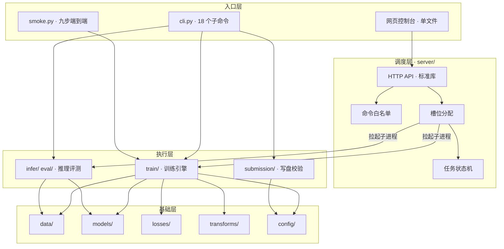
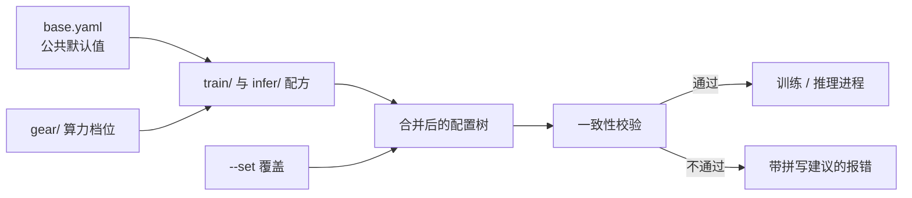
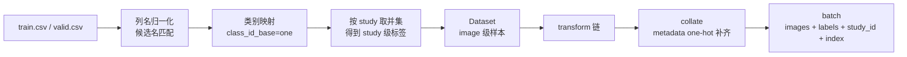
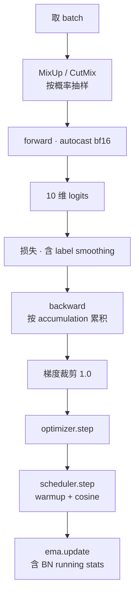
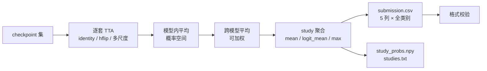
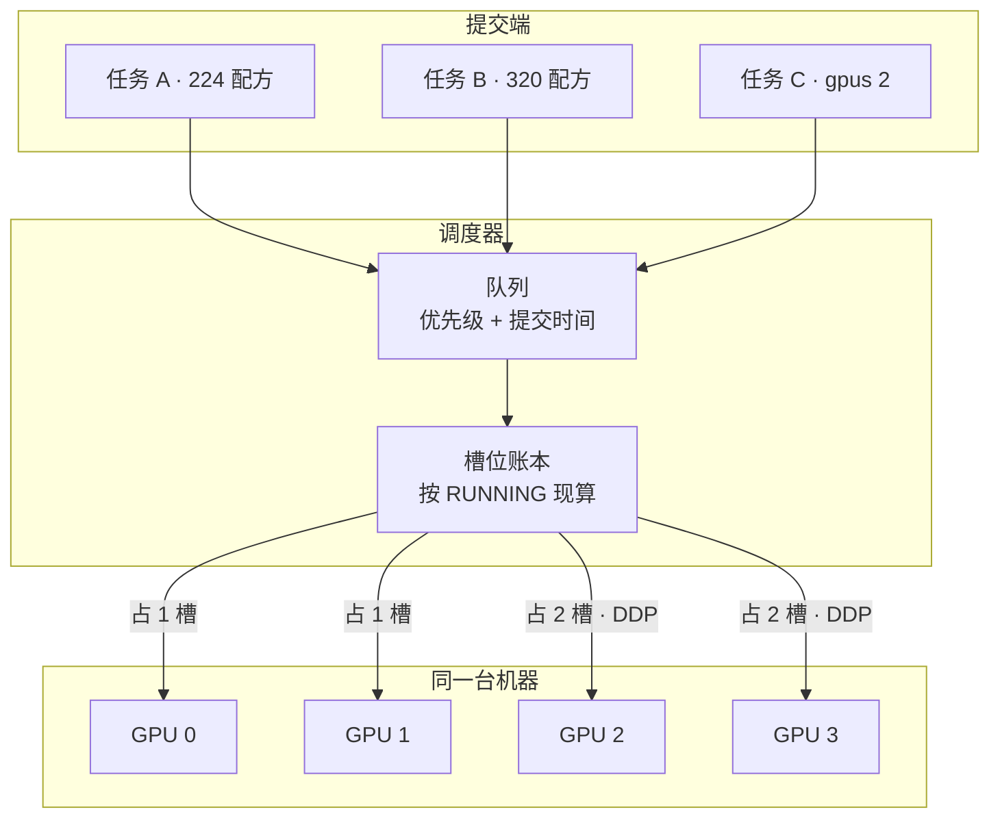
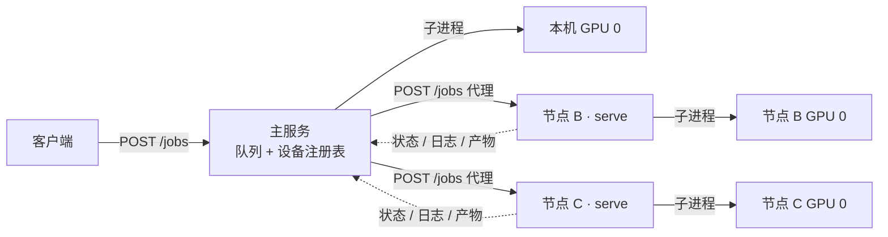
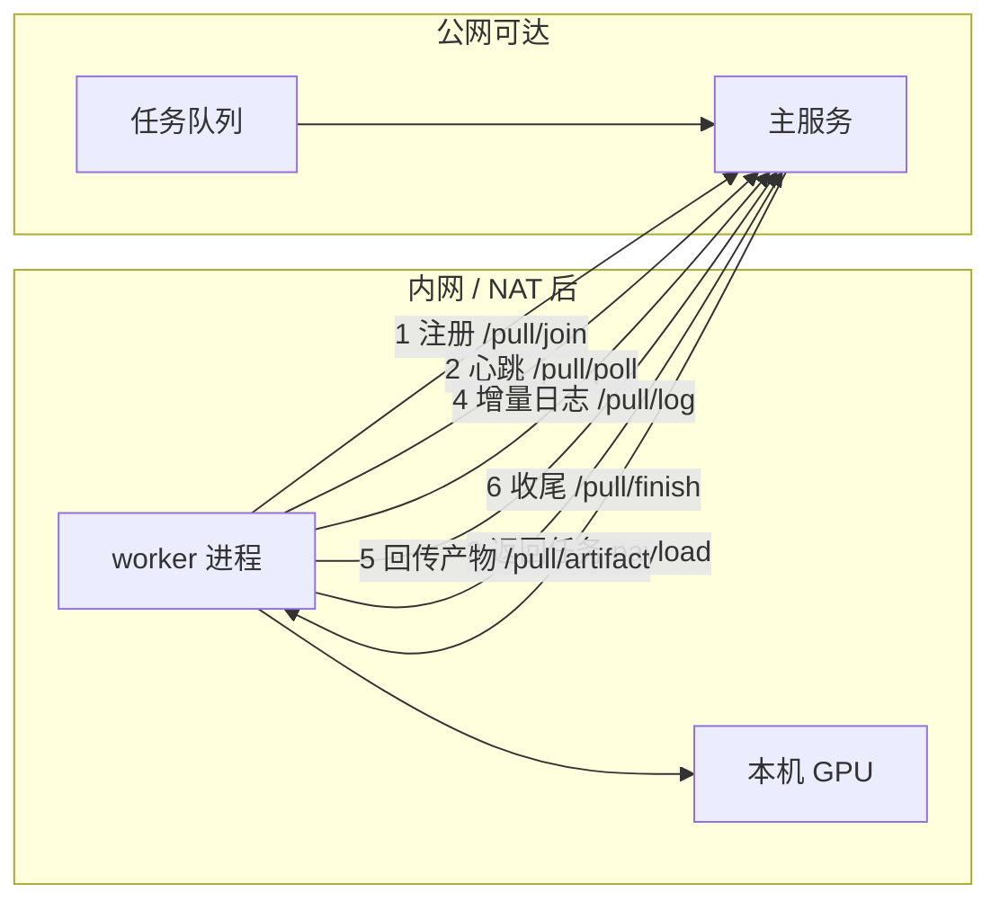
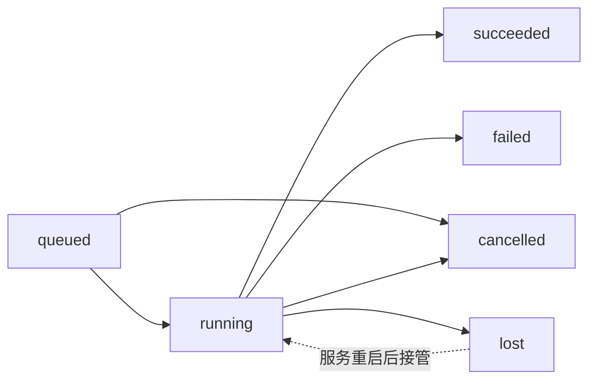
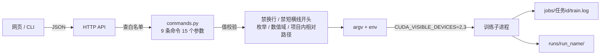

胸部 X 光，10 类多标签。一张图可以同时出现多个征象，也可以一个都没有。数据按 study 组织，一个 study 可能有两张不同体位的图，而提交是 study 级的。

我把赛题里"只用主办方数据"这条约束往前推了一步：连预训练权重也不用。DenseNet121 从 `weights=None` 起，6.96M 参数全部自己初始化。

这篇不讲踩坑，讲规格：每一层吃什么、吐什么、参数域在哪、失败边界在哪，以及为什么模块是这么切的。

## 一、约束到设计的映射

工程的重心不是"把模型训出来"，而是被三条约束决定的。

| 约束 | 具体含义 | 落到设计上 |
| --- | --- | --- |
| 主指标 Macro-AUC | 各类等权，稀有类和常见类同分 | 逐类算 AUC、退化类记 nan 并报跳过数；监控项固定 `macro_auc`；损失要给稀有类加权但不许压爆 |
| 提交是 study 级 | 每个 study 必须输出全部 10 个类别 | 训练在 image 级，评测与推理在 study 级聚合；`class_ids` 作为显式参数贯穿 |
| 只能用主办方数据 | 不并外部标注，不加载预训练权重 | 没有"通用视觉特征"兜底 → 初始化、正则、更长 schedule 变成主要杠杆 |

Macro-AUC 这条还带来一个隐性代价：它只看排序，不看阈值。所以召回率、F1 这类指标在调参时可以看，但不能当选择依据——选阈值调 F1 对 AUC 没有帮助。工程里 `submission.threshold` 只影响写进文件的 Gate 列，不参与模型选择。

## 二、分层与依赖方向

13.5k 行 Python 加 2.6k 行内联前端，切成十一块：

| 包 | 文件 | 行数 | 职责 |
| --- | --- | --- | --- |
| `config/` | 4 | 866 | 配置 schema、继承合并、设备解析 |
| `data/` | 8 | 1543 | 标签表、Dataset、study 聚合、泄漏检查、合成数据 |
| `models/` | 6 | 779 | DenseNet121 封装、初始化、DropPath |
| `losses/` | 2 | 401 | BCE / focal / ASL 与类别权重 |
| `transforms/` | 3 | 263 | 增强链、TTA |
| `train/` | 8 | 2334 | 引擎、优化器、EMA、DDP、checkpoint |
| `eval/` | 3 | 322 | 指标、评测入口 |
| `infer/` | 4 | 749 | 推理、集成、study 概率合并 |
| `submission/` | 2 | 337 | 写盘、格式校验 |
| `server/` | 11 | 4528 | 调度、设备注册、HTTP、网页 |
| `utils/` | 4 | 286 | IO、图像加载、随机种子 |

依赖只朝一个方向走：入口依赖执行，执行依赖基础。反过来没有一条引用。这条规则带来三个具体好处：

- **训练代码不知道自己被谁拉起。** 同一个 `run_training` 既能被 `_main_.py train` 直接调，也能被调度器当子进程拉，还能被 `torchrun` 拉成 N 个进程。三种形态同一份代码——判断依据是环境变量，不是命令行开关。
- **推理端不依赖训练端。** `infer/` 从 checkpoint 的 meta 里读 `transform`、`input_mode`、`class_ids`，不读训练配置文件。所以 224 训出来的模型和 320 训出来的模型可以混在一个集成里，各自按自己的规格预处理。
- **调度层碰不到训练细节。** `server/` 里没有一行 import `torch`。它只知道"给这条命令拼 argv、给这个进程分几张卡、回收它的产物"。代价是配置项要过一遍白名单，收益是调度服务能在没装 torch 的机器上跑（`devices: ["none"]` 时就靠这一点派活给拉取节点）。

## 三、配置规格

配置是唯一的超参来源。代码里没有硬编码的数字，也没有"改代码才能改行为"的开关。

继承是三层：`base.yaml` 放与算力无关的默认值，`gear/*.yaml` 只放设备相关项（workers、AMP、compile），`train/*.yaml` 和 `infer/*.yaml` 是配方，通过 `_base_` 指向父配置。

四条实现上的规定：

- **递归合并，循环检测。** `_base_` 可以套多层，解析时记录访问路径，出现环直接报错。相对路径按"引用它的那个文件所在目录"解析，所以 `configs/train/official.yaml` 里写 `default.yaml` 就够。
- **路径一律锚到项目根。** `data/*.csv`、`log.run_root`、`submission.out_path` 都按相对项目根解析。从任何工作目录启动，产物落在同一处。
- **`--set` 拼错键报错，YAML 里拼错只 warn。** 两者严格度不同是有意的：命令行是人在交互，立刻纠正最省时间（报错里带 `difflib` 的拼写建议）；YAML 可能是继承链上别人写的，直接失败会阻塞整条链。所以 `--set train.epochz=30` 会在**启动前**就拒绝，而不是跑完 30 个 epoch 才发现参数没生效。
- **校验在加载时一次性做完。** 目前的自检项：

| 检查 | 触发 | 后果 |
| --- | --- | --- |
| `num_classes` 三处一致 | `data` / `model` / 类别表冲突 | 拒绝启动 |
| `input_mode` 与 stem 一致 | 1 通道配置配 3 通道权重 | 拒绝启动 |
| `drop_path` 域 | 不在 `[0, 1)` | 拒绝启动 |
| `label_smoothing` 域 | 不在 `[0, 1)` | 拒绝启动 |
| RRC 参数域 | `scale_min > scale_max` 等 | 拒绝启动 |
| ASL clip | 负值 | 拒绝启动 |
| `epochs < 15` 配 MixUp | 正则比 schedule 强 | 警告 |
| 分辨率与显存 | 输入过大 | 警告 |
| DDP 参数 | `nprocs` 超过可见卡数 | 拒绝启动 |

默认值本身是一份立场声明，几处值得单独说：

- `transform.random_resized_crop: true`，`scale 0.70~1.0`、`ratio 0.90~1.12`。胸廓比例固定，不该像自然图像那样抖到 3:4；下界 0.70 是温和档，再狠会把要判别的结构本身裁掉。
- `transform.normalize` 用 `(0.5, 0.5, 0.5)`，不是 ImageNet 那组。没有预训练权重就没有理由沿用别人的统计量。
- `model.drop_path: 0.0`、`transform.mixup_p: 0.0`、`loss.label_smoothing: 0.0`。这三个都是"必须按数据量调"的强度项，默认关，`scratch_strong.yaml` 里才一起打开。
- `train.resume: true`。断点续训是默认行为，所以换实验必须换 `run_name`——同名 run 会从旧 checkpoint 接着跑，两次结果不可比。

算力档位只覆盖 `device.*`：

| gear | workers | AMP | compile | 用途 |
| --- | --- | --- | --- | --- |
| `mps_tiny` | 0 | 否 | 否 | 本机 Apple Silicon，受统一内存约束压小 batch |
| `cuda_full` | 8 | bf16 | 否 | 单卡 CUDA，比赛容器 |
| `cuda_ensemble` | 8 | bf16 | 是 | 集成阶段，多试一个编译加速 |

MPS 的限制是硬的：`num_workers` 必须 0，没有 AMP，没有 `pin_memory`，没有 `torch.compile`。这些不在各配方里重复写，统一在 `config/devices.py` 里按设备类型钳制。换机器只改 gear 一行。

## 四、数据层规格

数据层的输入是两张 CSV 加一棵图片目录，输出是 batch。

几处必须写死的约定：

**列号按 class id 定位，绝不压缩重编号。** 如果一批样本只出现了 5 个类，内部把它压成 5 列，训练和提交的列序就分叉了。所以训练定死顺序，验证和推理必须显式传 `class_ids=`，不靠"缺省推断"兜底。这条规则在三个地方各有一道断言：数据集构造、指标计算、提交校验。

**`class_id_base` 显式钉成 `one`。** 官方是 1 起始（1..10）。`auto` 推断在数值重合时会告警，不值得冒那个险——所以配置里直接写死，不走推断路径。

**标签按 study 取并集。** 一个 study 下多张图，任一张报了这个征象，study 级标签就是 1。训练用 image 级标签（同一 study 的图共享标签），评测和推理用 study 级。

**study 聚合三种口径。** 差异只在"在哪一步平均"：

| 方法 | 做法 | 适用 |
| --- | --- | --- |
| `mean` | 概率直接平均 | 默认。图之间质量差异不大时最稳 |
| `logit_mean` | 先转 logit 再平均 | 概率接近 0/1 时，避免被单张图的极端值拉平 |
| `max` | 取最大概率 | 只在"任一张图有就算有"的语义下用，会系统性偏高 |

**`study_ids` 是权威清单。** 聚合输出严格等于传入的清单，清单外的预测告警并忽略，清单内没有图的 study 填先验值（默认 0.5）。少了这层约束，一次提交缺行或错位要到上传后才看得出来。

**泄漏检查先跑。** train 和 val 按 `Subject_id` 分组，同一患者的图不许跨 split。如果官方切分在患者级别不干净，本地验证分数会虚高，早停会停在错的位置，而这个错误在提交前完全看不出来。K 折同理，`GroupKFold` 按 `Subject_id` 分，不是按 study。

**元数据是可选分支。** `use_metadata: true` 时把 `ViewPosition` / `PatientOrientation` / `Support Devices` 做 one-hot，接一个 32 维 MLP 后与图像特征拼接。词表存进 checkpoint 的 meta，推理端按训练时的词表编码，遇到没见过的值落到 `__missing__` 桶。默认关闭——多一路输入就多一处会错位的地方，除非验证集上确实有收益。

## 五、模型规格

骨干是 torchvision 的 DenseNet121，改了三处：

| 改动 | 原实现 | 现在 | 原因 |
| --- | --- | --- | --- |
| stem | `Conv2d(3, 64, 7, stride=2)` | `Conv2d(1, 64, 7, stride=2)` | 灰度图直接进 1 通道。没有预训练权重，就没有"复制成 3 通道复用"的理由；`repeat3` 只留作对照 |
| 池化 | `AdaptiveAvgPool2d(7)` 后接固定维度 | `AdaptiveAvgPool2d(1)` | 支持任意输入分辨率，224 / 320 / 448 同一份代码 |
| 分类头 | 单层 Linear 1024→1000 | 单层 Linear 1024→10 | `head_hidden=0` 时就是单层；给隐藏层则插一层 + GELU |

输出是 10 维 logits，不接 sigmoid。sigmoid 放在损失和推理里各做一次，模型本身保持纯线性输出——`BCEWithLogitsLoss` 和 `F.binary_cross_entropy_with_logits` 都需要 logits，提前 sigmoid 会让数值不稳定。

实测规模：

| 项 | 值 |
| --- | --- |
| 参数量 | 6.96M |
| fp32 体积 | 26.5 MB（赛题上限 500MB，余量足够） |
| 单样本前向（本机 CPU） | 30.9 ms @224，49.0 ms @320 |

CPU 数字不能直接当 T4 的延迟，但它说明一件事：这个规模下"能不能塞进 100ms"不是瓶颈，能不能在时限内训完才是。

### 初始化：把起点当成先验注入点

从零训练时，初始化不是"随便填个数"，而是唯一能免费注入先验的地方。

| 参数 | 策略 | 规格 |
| --- | --- | --- |
| 卷积 / 线性权重 | Kaiming 正态，`fan_out` + relu | 每个卷积后都跟 BN，`fan_out` 版比 PyTorch 默认的 `kaiming_uniform(a=√5)` 更合适 |
| BN 权重 / 偏置 | 1 / 0 | 恒等变换起步 |
| 分类头权重 | 零初始化 | 初始 logits 精确等于偏置 |
| 分类头偏置 | `log(p/(1-p))`，p 为该类在训练集的频率 | 再 clamp 到 ±6.0 |

分类头那两条合起来的效果：训练第 0 步，模型输出就是"按类别先验猜"。这步不花钱，但省掉开局把偏置推到位的几十步梯度。clamp 到 ±6.0 是为了防极端不平衡——如果某类频率是 1/10000，`log(p/(1-p))` 会给到 -9.2，配上零权重会让这部分梯度长期停在极小值区。

### 随机深度：按层深线性铺开

DropPath 的速率按密集块索引线性插值：

$$
p_l = p_{\max} \cdot \frac{l}{L-1}, \quad l = 0, \ldots, L-1
$$

浅层不丢，最后一层丢到 `p_max`。实现上挂在 `_DenseLayer` 上，通过 `add_module` 注册成子模块——这一点是必须的：只留 hook 闭包的话 `.eval()` 传播不到它，推理时仍在随机丢分支，同一张图两次预测不一样，而且完全不报错。挂上去之后 `state_dict` 的键名不变，开关它不会让旧 checkpoint 失效。

### 损失

四种，同一个接口，共享标签平滑：

| 类型 | 式子 | 参数域 |
| --- | --- | --- |
| `bce` | 标准二元交叉熵 | — |
| `bce_posw` | BCE 乘逐类 `pos_weight` | `neg/pos`，clip 到 `[1e-3, cap]` |
| `focal` | `-(1-p_t)^γ · log p_t` | `γ` 默认 2.0 |
| `asl` | 正负样本不同 γ，负样本概率先平移再算 | `γ_pos=0`、`γ_neg=4`、`clip=0.05` |

标签平滑把目标从 `y` 软化成 `y(1-ε) + 0.5ε`。因为官方标签来自报告"正面提及"，漏标比误标常见，软化比硬标签更贴合噪声结构。

`pos_weight` 必须截断上限（默认 20）。稀有类正例可能只有个位数，`neg/pos` 会到几百，不截断的话梯度被放大两个数量级，一个 batch 就能把训练带崩。

ASL 和 `pos_weight` 同时开是**双重加权**正类（`γ_pos=0` 不降权，`pos_weight` 再乘一遍），所以 `scratch_strong.yaml` 里把 cap 从 20 降到 10。真出现稀有类变差，第一步是把 `pos_weight` 整个关掉，用纯 ASL。

另有一层类别权重 `loss.class_weights`，按 class id 给每类一个乘数，内部归一化到均值为 1 以免整体 loss 尺度变化。这层是给"某几类一直上不去"精修用的，不是常规手段。

### 增强链

只用 `torchvision.transforms.v2`，不引 albumentations。少一个依赖，离线环境少一类问题。

| 顺序 | 算子 | 概率 / 参数 |
| --- | --- | --- |
| 1 | `ToImage` + `Grayscale(1)` | 强制单通道 |
| 2 | `RandomResizedCrop` 或 `Resize + RandomCrop` | scale 0.70~1.0，ratio 0.90~1.12 |
| 3 | 水平翻转 | 0.5 |
| 4 | 旋转 | ±10° |
| 5 | 仿射平移 | p=0.05 |
| 6 | 亮度 / 对比度 | 各 0.2 |
| 7 | `ToDtype` | 到 `[0,1]` |
| 8 | `RandomErasing` | 0.1（320 档降到 0.05） |
| 9 | `Normalize` | mean/std 全 0.5 |

不做色相饱和度——灰度图没有意义。MixUp / CutMix 是批次级增强，在 collate 之后、forward 之前做，不在这条链里。

MixUp 在多标签下的做法是：同一 λ 混图，也同一 λ 混标签。λ 从 `Beta(α, α)` 采，`α=0.4`。这里有个容易照抄错的数：原论文的 `α=0.2` 在 `Beta(0.2,0.2)` 下是 U 形分布，实测 λ 会落到 0.006——图像和标签几乎整批被换成另一个样本，既不是"混合"也学不到插值语义。0.4~1.0 才是这个场景的合理区间。

CutMix 的 λ 按真实粘贴面积重算，不是用 Beta 采样值直接当面积比。

## 六、训练规格

一次迭代的顺序是固定的：

### 优化器分组

AdamW，参数最多分成 4 组：head / backbone × 衰减 / 不衰减。

| 组 | 成员 | weight decay |
| --- | --- | --- |
| `head` | 分类头权重 | `train.weight_decay` |
| `head:no_wd` | 分类头 bias | 0 |
| `backbone` | 主干卷积与 BN 权重 | `train.weight_decay` |
| `backbone:no_wd` | BN bias、BN weight | 0 |

不衰减的判定是 `ndim <= 1` 或名字以 `.bias` 结尾。AdamW 的衰减是解耦的，对 1 维参数做衰减等于把 BN 的尺度参数往 0 拽，直接削弱归一化层的表达能力。这是从零训练配方里少有的纯赚改动。

`backbone_lr_scale` 可以给主干一个 lr 乘数（默认 1.0）。想先训头再放开主干时用它，比冻结更平滑——冻结会让主干完全不更新，放开那一刻梯度分布会突变。

### 学习率

warmup 线性升温，之后余弦退火，按 step 算不是按 epoch：

$$
\eta_t = \begin{cases}
\eta_0 \cdot \dfrac{t}{T_w} & t < T_w \\[6pt]
\eta_{\min} + \tfrac{1}{2}(\eta_0 - \eta_{\min})\left(1 + \cos\pi \dfrac{t - T_w}{T - T_w}\right) & t \ge T_w
\end{cases}
$$

`T_w` 是 warmup 步数，`T` 是总步数。早期 BN 的 running stats 还没稳，一上来用 3e-4 容易落进坏解；warmup 让前两个 epoch 的等效步长从 0 爬到目标值。

### EMA

对所有权重和 BN 的 running stats 做指数滑动平均，`decay=0.9998`，前 100 次更新做 decay warmup（从 0 线性升到目标值，避免初期被随机初始化拖住）。

排序指标对权重抖动敏感，EMA 权重通常比最后一个 epoch 更稳。它作为一个独立 checkpoint 落盘（`best_ema.pt`），不覆盖 `best.pt`。评估 EMA 时要临时把影子权重换进模型（`swapped_into` 上下文），换出来再存——顺序错了会把 EMA 权重写成当前权重。

### 早停与落盘

监控项 `macro_auc`（最大化），`min_delta=0`，耐心 8 个 epoch。checkpoint 保留 top-2，多余的 epoch 快照在训练结束时按监控值剪枝。

`train.resume: true` 时从 `last.pt` 续训。这里有个静默边界：如果 epoch 已经用尽，续训会一个 batch 都不跑就正常退出（`exit=0`），产物里 `epochs_ran=0`。所以调度器回收任务时不看退出码，看 `summary.json` 的 `epochs_ran`。

### DDP 约束

单任务多卡时，N 个进程同步同一份权重，产物只有一份。

| 项 | 规定 |
| --- | --- |
| 启动方式 | 按 `torchrun` 的环境变量约定起子进程，不用 `spawn` |
| backend | CUDA → `nccl`，其余 → `gloo` |
| 数据切分 | `DistributedSampler`，每 epoch 手动 `set_epoch`，否则每个 epoch 的划分相同 |
| 验证集 | 各 rank 分别推理，`all_gather_object` 汇总后统一算指标 |
| 落盘 | 只有 rank 0 写 checkpoint 和日志 |
| 冻结主干 | 冻结时开 `find_unused_parameters`，否则 DDP 会抱怨有参数没参与反传 |
| 随机种子 | rank 0 之后各 rank 错开，否则各进程的增强完全一致，等于没有增强 |
| MPS | 直接拒绝。MPS 没有集合通信后端，多卡自测请用 CPU + gloo |

多卡任务只能落在**同一台机器**上。DDP 的梯度同步靠本机 NCCL，跨机器不成立。调度器把"同一台机器"作为分配单位，凑不齐就整单排队，不会拆到两台机器上各训各的。

## 七、checkpoint 契约

格式标识 `csd-checkpoint-v1`，payload 是纯字典：

| 键 | 内容 |
| --- | --- |
| `meta` | `model` / `transform` / `class_ids` / `class_names` / `metadata_vocab` / `study_agg` / `input_mode` |
| `model` | 裸 `state_dict` |
| `epoch` / `metrics` / `ema_applied` | 训练进度与当轮指标 |
| `optimizer` / `scheduler` / `ema` | 只在续训时写入 |

三条规定：

- **只存 `state_dict`，不 pickle 整个模型对象。** 本机 torch 版本比比赛容器新，pickle 过去的对象在容器里会直接加载失败；`state_dict` 不会。加载时用宽松模式，缺键告警而不是直接崩。
- **meta 里的 `transform` 是推理端的唯一依据。** 这样 224 和 320 的模型能混在一个集成里，各自按自己的规格预处理。少这一层，就必须"记得当时用的哪个配置"，而人一定会记错。
- **保存前把模型从包装里剥出来。** DDP 包一层、`torch.compile` 再包一层，直接存会得到 `module._orig_mod.xxx` 这种带前缀的键名，换台机器就加载不上。

## 八、推理与提交流水线

**平均在概率空间做，不在权重空间。** 权重平均（model soup）要求各模型在同一条损失曲面上，从零训练的不同配方不满足这个条件，平均出来的模型往往比任何一个都差，所以不实现。概率平均是安全的：它只要求各模型输出可比较。

**三类产物一起落盘。** `submission.csv` 是提交物，`*_study_probs.npy` 和 `*_studies.txt` 是 study 级概率和清单。后者存在的理由是"一张卡一个折"的跑法：那时候没有一个进程同时持有 N 个模型，`predict --ckpt A --ckpt B` 用不上，而为了集成再跑一遍推理纯属浪费。有了概率落盘，`scripts/merge_study_probs.py` 在 CPU 上按 study 名对齐求平均，秒级完成且完全可复现。

**每份概率必须覆盖同一批 study。** 少一个就是提交缺行，脚本直接报错而不是取交集——取交集是静默丢数据。

**提交格式是五列，固定：**

| 列 | 语义 | 约束 |
| --- | --- | --- |
| `Subject_id` | 患者 id | 与 test 表一致 |
| `Study_id` | 检查 id | 零填充字符串，绝不按数值解析 |
| `Predict_class` | 类别 id | 1..10，每个 study 输出全部 10 行 |
| `Probability` | 概率 | `[0,1]`；越界超过 1.0 几乎肯定是把 logits 写进去了 |
| `Gate` | 阈值 | 留空表示用默认阈值；也可以填 0~1 |

写盘是 tmp → rename 的原子操作，避免中途失败留下半个文件。校验项：

| 检查 | 失败含义 |
| --- | --- |
| 表头与列数 | 格式直接判错 |
| 类别覆盖 | 某 study 缺类 |
| `Subject_id` 冲突 | 同一 study 挂了两个患者 |
| 概率域 | 超界，通常是 logits 泄漏 |
| 重复行 | 同 study 同类出现两次 |
| 空 `Gate` | 允许；非空则必须是数字 |

推理前还有一道预算检查：模型总体积不超过 500MB，单样本延迟不超过 100ms。DenseNet121 是 26.5MB，权重上限允许十几个模型，真正的天花板是延迟——所以集成的规模由时延决定，不是由体积决定。

## 九、调度服务：三种部署形态

单卡跑一个配方很快。真正要跑的是"多组超参 × 多折"，手动开终端会乱。所以把"跑什么"和"在哪跑"拆开，中间放一层调度。

两种并行同时存在，不能混：

- **任务级并行**（默认）：一个任务占一个槽位，产物是各自的 `runs/<run_name>/`。适合扫超参、跑多折。
- **单任务多卡**（`--gpus N`）：一个任务独占 N 个同机槽位，进程内 DDP 同步同一份权重，只产出一份 `best.pt`。这不是集成，是一个更大的 batch。

两者可以混用：4 卡机器上跑两个 `--gpus 2` 的任务，各自出各自的一个模型。

### 形态一：本机，两类并行

槽位账本不维护计数器，每次派发都从任务状态现算。任务状态本来就落盘了，再维护一份内存计数只会多一个不同步的地方——而不同步的表现是两张卡被派了三个任务，症状是莫名 OOM。

### 形态二：多机，主服务主动派

远程机器上跑一个**同样的 `serve`**。主服务把任务 `POST` 过去，之后状态、日志、产物全部代理回来。远程端零改代码，代价是远程要有同一份项目代码与数据。

派发时只能发**相对配置路径**。两台机器的绝对路径不同，发绝对路径过去，对方只会回"配置文件不存在"——而且是在任务已经显示"运行中"之后才失败。所以配置路径在提交时就被锁进项目目录，派发时转成相对路径。

多卡任务派到远程时不指定具体槽位，只发"要几张卡"，具体挑哪几个由远程自己的注册表决定。主服务这边登记的 `节点B:0..3` 只负责把"这台机器被占了几张"记清楚。

### 形态三：拉取节点，worker 主动出站

上面的模式要求主服务能连到节点。校园网、NAT、容器网络下经常不成立。拉取节点反过来：worker 主动来注册、领任务、回传。

协议只有五个端点，全是 worker 发起：

| 端点 | 方向 | 语义 |
| --- | --- | --- |
| `/pull/join` | worker → 主 | 注册 + 上报 GPU 数 |
| `/pull/poll` | worker → 主 | 心跳、领任务、查取消标记 |
| `/pull/log` | worker → 主 | 增量日志追加 |
| `/pull/artifact` | worker → 主 | 原始字节流上传产物 |
| `/pull/finish` | worker → 主 | 回执状态、退出码、指标 |

失联判定按心跳断开的时长：30 秒不再算在线（不再派新任务），120 秒判 `lost`。中间这段时间任务仍显示运行中——它确实可能还在跑。

取消也走轮询：主服务在任务上置 `cancel_requested`，worker 下次心跳取走标记，自己在本地杀进程组。没有反向通道，就不可能有"推送取消"。

三种节点放在一起对比：

| | local | remote | pull |
| --- | --- | --- | --- |
| 谁发起连接 | 无（同进程 fork） | 主服务 → 节点 | worker → 主服务 |
| 适用 | 本机 GPU | 同网段、主服务能连到对方 | NAT 后、校园网隔离 |
| 失联判定 | 进程退出即可知 | 连续 120 次轮询失败 | 心跳断 120 秒 |
| 日志与产物 | 本地直读 | 主服务代理 | worker 上传后本地直读 |

### 任务状态机

`lost` 这个状态是必要的，它不是 `failed`。失联只说明"不知道结果"，不代表训练失败——服务重启后，远程任务和拉取任务都会被拉回 `running` 重新接管，再由心跳或轮询给出真实结论。

三个与进程生命周期有关的约束：

- **用 `CUDA_VISIBLE_DEVICES` 屏蔽，不传 `cuda:1`。** 训练进程只看得到分到的那几张卡，代码里任何 `device="cuda"` 都会落到正确位置。也就不存在"某处漏改 `cuda:0` 把两个任务挤到同一张卡"的可能。多卡时给整组卡，rank 由 `LOCAL_RANK` 分。
- **`start_new_session=True`，回收时杀进程组。** 训练会 fork DataLoader worker，DDP 还会再起 N-1 个子进程。只杀父进程会留下一串孤儿占着显存，后续任务全部 OOM，而现象是"新任务莫名失败"。这两代子进程继承同一个进程组，`killpg` 一次带走；10 秒不退再 `SIGKILL`。
- **结果以 `summary.json` 为准，不以退出码为准。** `exit=0` 不代表真训了东西。

## 十、接口规格

网页和 CLI 走同一套 HTTP 接口，服务端是纯标准库的 `ThreadingHTTPServer`，没有 Flask/FastAPI 依赖。

| 方法 | 路径 | 语义 |
| --- | --- | --- |
| GET | `/` `/ui` | 控制台页面（鉴权前放行） |
| GET | `/health` | 概览 + 设备占用 + 队列计数 |
| GET | `/commands` `/configs` | 命令白名单、可选配置清单 |
| GET | `/datasets` | 扫描 `data/` 或体检任意目录 |
| GET | `/devices` | 槽位列表与占用数 |
| GET | `/jobs` `/jobs/{id}` | 任务列表 / 单个任务 |
| GET | `/jobs/{id}/log` | 日志尾部 |
| GET | `/jobs/{id}/artifacts[/name]` | 产物列表 / 下载 |
| POST | `/jobs` | 提交任务 |
| POST | `/jobs/{id}/rerun` | 用同样参数再提交 |
| DELETE | `/jobs/{id}` | 取消 |
| POST/PATCH/DELETE | `/devices[...]` | 增删改槽位、探测 |
| POST | `/pull/*` | 拉取节点协议 |
| GET | `/env/doctor` `/env/config` | 环境自检、生效配置回显 |

白名单是唯一入口。网页能触发的命令和参数全部登记在 `server/commands.py` 一张表里，每条命令声明四件事：`config_kind`（要不要配置、要哪类）、`injects_run_name`（产物是否按 run_name 落目录）、`artifacts`（产物在 run / submission / 无）、`multi_gpu`（能不能多卡）。未登记的键直接报错。

值校验的规则不复杂，但每条都有具体理由：

| 规则 | 理由 |
| --- | --- |
| 禁止换行 | 换行能拼出第二条命令 |
| 禁止以 `-` 开头 | `--ckpt --help` 等于绕开白名单塞入新选项 |
| 路径必须项目内相对、无 `..` | 客户端不该能读服务器上任意路径 |
| 枚举 / 数值域 | 拼错的参数要在提交时报错，而不是跑完才报 |

产物也有白名单。训练任务能下载的只有 `summary.json`、`history.csv`、`config.yaml`、`train.log`、权重文件和 kfold 汇总这 8 类；推理任务是 `submissions/` 下的三类文件。这既是功能，也是边界——它决定了"客户端能读服务器上哪些文件"。

### 网页控制台

单文件，CSS 和 JS 全内联，零外部请求。内网没有外网也照常显示，没有前端构建步骤。

几个实现上的取舍：

- **页面在鉴权之前放行。** 浏览器地址栏导航发不出 `Authorization` 头，拦掉首页只会让用户看到浏览器的原生密码框，输完照样 401。页面本身是静态 HTML，不含数据，前端拿到 401 再弹输入框。
- **日志 2 秒轮询，不上 SSE。** 任务状态是分钟级变化，多一条长连接只多一处会断的东西。
- **详情面板只在状态字段变化时重建。** 否则 2 秒一次的刷新会把正在回看的日志滚动位置冲回底部。
- **产物下载走 fetch → blob。** 直接给 `a href` 带不上鉴权头。

前端不做任何业务校验。参数域、路径合法性、命令合法性全在服务端判定，页面只按 `kind` 出控件（int / float / enum / multi）。

## 十一、验证矩阵

381 项单测（本机约 30 秒），覆盖的是"会静默出错"的那部分：

| 测试文件 | 覆盖 | 关键断言 |
| --- | --- | --- |
| `test_losses.py` | 四种损失、类别权重、平滑 | 损失与设备无关；`pos_weight` 上 CUDA 不炸 |
| `test_drop_path.py` | 随机深度 | 推理两次输出一致；state_dict 键名不变 |
| `test_mixup.py` | MixUp / CutMix | λ 与标签一致；batch < 2 静默跳过 |
| `test_optimizer.py` | 参数分组 | BN 与 bias 落在 `:no_wd` 组 |
| `test_init_weights.py` | 初始化 | 头权重为零时 logits 等于先验 |
| `test_checkpoint.py` | 断点格式 | 只存 state_dict；快照剪枝按监控值 |
| `test_distributed.py` | DDP | 真起两个进程跑一轮；采样器 epoch 递增 |
| `test_server.py` | 调度闭环 | 派发、取消、失联判定、产物白名单 |
| `test_pull_worker.py` | 拉取协议 | 领任务、取消、上传、重启后判 lost |
| `test_cli.py` | 子命令分发 | 每个子命令的 `args.command` 仍是自己 |
| `test_submission.py` | 提交格式 | 五列、全类别、概率域、重复行 |

九步端到端冒烟跑在合成数据上：

合成数据是本地画的高斯亮斑，类别信息直接编码进图像，所以模型学得动。这不是为了刷分，是为了证明**标签、图像、增强、损失、聚合、提交这条链上没有错位**：如果 AUC 落在 0.5 附近，说明标签和图像对不上；能到 0.63 左右，说明整条链是通的。

本机 MPS 上九步跑完 34 秒，`best macro_auc=0.6298`，提交 12 个 study / 120 行 / 每 study 恰好 10 行。这些数字没有实战意义，它们的价值是可复现：换一台机器跑同一条命令得到同一组数，说明没有哪一步偷偷依赖了本机状态。也让"换真实数据只改配置里的路径"这句话变得可验证。

## 十二、现在的状态

- 全链路在合成数据上跑通，冒烟 9/9。
- 从零训练的四类手段（初始化、正则、损失、增强）都是独立开关，默认保守，可逐项消融。
- 调度服务三种形态可用：本机（任务级并行或单任务多卡）、主动派发的远程节点、被动拉取的 worker，都有端到端测试。
- 数据到手后的顺序已定：先跑患者泄漏检查，再用默认配方标定基线，然后逐项打开 `scratch_strong` 里的开关看五折平均，最后才谈高分辨率、TTA 和集成。

调参这件事，先保证每次只改一个变量，再谈提分。

---

代码在 `cixiy1/ChestSmartDiagnosis`，MIT 许可。仓库目前是私有的，赛后按赛制要求决定是否开放。
