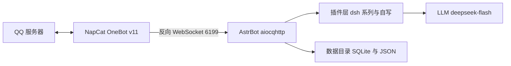

我想在 QQ 群里养个 AI：能看图，能发表情包，记得住人，冷场会自己开口，说话有脾气而不是客服腔。花了两天从零搭完，中间踩了三个真坑。按顺序写下来，命令、路径、日志都是本机实测。

**文中 QQ 号和群号已打码**：主人 `213****636`、机器人自己 `283****679`、主群 `105****275`，换成你自己的就行。

**实测环境**

| 项 | 值 |
|---|---|
| 机器 | MacBook Air M2（arm64） |
| 系统 | macOS 26.x |
| 框架 | AstrBot 4.29.3 |
| 协议端 | NapCat（OneBot v11，反向 WebSocket） |
| 模型 | DeepSeek `deepseek-flash` |
| 安装方式 | `uv tool install astrbot` |
| 最终插件数 | 51（45 个外部 + 6 个自写） |

**边界**：只在自己的群和私聊里跑，不群发，不加陌生群，不转发他人消息到外部。AstrBot 接的是你自己的 QQ 号，账号风险自己承担。

---

## 一、我要什么

动手前先列清单，后面选插件、写补丁都对着它做：

| 需求 | 落到哪一层 |
|---|---|
| 一直在线 | 进程保活（launchd）+ 协议端不掉线 |
| 有人格，不是客服 | 系统提示词里的人格 + 出口侧拦截 |
| 认主人 | 主人事实注入 + 各插件的主人豁免 |
| 自己写记忆 | 给模型可调用的写工具，落进同一张表 |
| 能发表情包 | 表情包库（按 md5 认图）+ 文字表情转真表情 |
| 主动开口 | 冷场计时 + 定时唤醒 + 作息限制 |
| 看得懂图 | 视觉模型（这条最后没做成，见文末） |

---

## 二、三层架构



NapCat 只负责登录 QQ、收发协议包，不碰逻辑。AstrBot 负责适配、插件调度、接模型。两边用 OneBot v11 的 WebSocket 连。

选反向 WS 是因为 AstrBot 这边做服务端，NapCat 主动连过来，重启 AstrBot 不用改 NapCat 配置。

---

## 三、装 AstrBot

```bash
uv tool install astrbot
astrbot --version        # AstrBot, version 4.29.3
```

装完可执行文件在 `~/.local/bin/astrbot`。第一次跑会初始化数据目录：

```bash
export ASTRBOT_ROOT=/Users/yuki     # 不设也行，但必须在 /Users/yuki 目录下运行
cd /Users/yuki
astrbot run
```

初始化后目录长这样：

```
/Users/yuki/data/
├── cmd_config.json      # 主配置：平台、模型、人格
├── data_v4.db           # 主库
├── plugins/             # 插件目录
├── config/              # 每个插件自己的配置
├── logs/astrbot.log     # 日志
└── temp/                # 收图/收语音的临时目录
```

WebUI 默认在 `6185`，浏览器打开 `http://127.0.0.1:6185` 设账号密码。

注意：升级后密码从明文换成了 pbkdf2，老密码会失效。后面要用 API 的话，直接从 `cmd_config.json` 读 `dashboard.jwt_secret` 自签令牌更省事，见「热重载」一节。

---

## 四、装 NapCat 并接上

用官方安装器（macOS 上是 `NapCatInstaller`）装好后扫码登录。然后在 NapCat 的网络配置里新建反向 WebSocket：

| 项 | 值 |
|---|---|
| 类型 | 反向 WebSocket |
| URL | `ws://127.0.0.1:6199/ws` |
| 消息格式 | Array（CQ 码风格，AstrBot 侧默认） |

对应 AstrBot 的 `data/cmd_config.json`：

```json
"platform": [
  {
    "id": "default",
    "type": "aiocqhttp",
    "enable": true,
    "ws_reverse_host": "0.0.0.0",
    "ws_reverse_port": 6199
  }
]
```

验证接通：

```bash
tail -f /Users/yuki/data/logs/astrbot.log | grep -i aiocqhttp
```

看到连接建立、上线事件推过来就算通。此时私聊机器人应该已经有反应，用的是默认人格，会很客服。

---

## 五、接模型

WebUI 的「服务提供商」页里加一个 OpenAI 兼容源，填 DeepSeek 的 base URL 和 key，然后加模型：

```json
"provider": [
  {
    "id": "deepseek/deepseek-flash",
    "enable": true,
    "provider_source_id": "deepseek",
    "model": "deepseek-flash",
    "modalities": ["text", "image", "tool_use"],
    "max_context_tokens": 1000000
  }
]
```

`modalities` 里写 `image` 只是声明它"可以"接图，不等于有视觉能力。`deepseek-flash` 是纯文本模型，「看得懂图」这条会卡住，文末交代。

---

## 六、人格只放系统提示词

人格我用了 whyever77 的 `dafeiyu-astrbot` 仓库，文件是 `persona/大肥鱼-人格.md`，抖音版那套。她自称**本鲸**，叫用户**鱼片**，被叫"大肥鱼"会小声抗议。比常见的"温柔女仆 AI"有脾气得多，是我要的。

导入方式两种：直接放进 AstrBot 的人格页，适合只有一份人格的场景；或者插件注入，适合人格要按群、按人切换。

我选了第一种，而且给自己立了条规矩：**人格只放系统提示词，插件一律不写人格，只补事实**。

这条规矩后面救了命。插件库里有一批"人格类"插件（persona-core / selfaware / factguard / scene / will / agency），各自往提示词里塞一段"你应该怎样"，跟抖音版人格正面冲突。结果就是说话一会儿像 ChatGPT 一会儿像鲸鱼娘。解决见下一节。

---

## 七、插件：挑着装，冲突的自写

参考仓库带 40 多个 `dsh-*` 插件，全装会打架。分类挑：

| 类别 | 代表插件 | 装不装 | 理由 |
|---|---|---|---|
| 人格 / 自我认知 | persona-core、selfaware、factguard、scene、will、agency | **不装** | 跟抖音版人格冲突，自写 `_core` 替代 |
| 记忆 | dsh-memory、dsh-merge、dsh-social | 装 | 自动抽取事实，按会话分桶 |
| 主动开口 | dsh-initiate、dsh-proactive、dsh-interest | 装 | 冷场触发、每日额度、作息 |
| 群内行为 | dsh-repeat、dsh-quote、dsh-typo、dsh-welcome、dsh-noise | 装 | 复读、引用、口误、欢迎 |
| 边界防护 | dsh-armor、dsh-spine、dsh-claimguard、dsh-leakguard、dsh-selfguard | 装 | 防注入、防塞设定、防泄露提示词 |
| 表达 | dsh-style、dsh-glossary、dsh-homophone、dsh-express | 装 | 语气、黑话、谐音梗 |
| 识图 | dsh-imgctx、dsh-vischain | 装但空转 | 没有视觉模型 provider |
| 表情 | dsh-sticker、dsh-steal、face_convert | 装 | 偷图入库、文字表情转真 QQ 表情 |
| 日程 | schedule_awareness | 装 | 让她知道自己名下的定时任务 |

最终 45 个外部插件。冲突那六类的活儿，我用六个自写插件补上：

| 插件 | 干什么 |
|---|---|
| `astrbot_plugin_dafeiyu_core` | 事实锚（被问身份按事实答，不编肉身经历）、出口拦截（不许把 traceId/API 报错发进群）、意志（被踩线真的不回）、群场景（哪个群、几点）、心跳 |
| `astrbot_plugin_dafeiyu_notes` | 给她三个工具 `remember` / `recall` / `forget`，直接写进 dsh-memory 的 facts 表——跟自动抽取的记忆同一张表、同一条注入链路，不另起炉灶 |
| `astrbot_plugin_dafeiyu_stickerlib` | 表情包按内容 md5 建库，同一张图再出现她认得出名字；想发就写 `[表情包:名字]`，插件发原图。不依赖视觉模型 |
| `astrbot_plugin_dafeiyu_crossmem` | 跨会话记忆：私聊当总账本，群里只带全局条目，别人的档案换会话不给看 |
| `astrbot_plugin_dafeiyu_qzone` | 说说相关 |
| `astrbot_plugin_dafeiyu_fspatch` | 文件系统兜底，见「坑三」 |

自写插件我统一按 fail-open 写：读不到库、抛异常、超时一律放行，绝不挡正常回复。一个插件崩了就全群哑火，代价太高。

---

## 八、坑一：插件里的硬编码 `/AstrBot/data`

### 现象

插件加载成功，但日志里一片：

```
[dsh-mind] OperationalError: unable to open database file
[dsh-acl] 扫描目录不存在: /AstrBot/data/plugins
[dsh-effect] 状态读取失败
```

### 先分清"路径错"还是"没触发"

全库扫一遍硬编码：

```bash
grep -rn '"/AstrBot/data' /Users/yuki/data/plugins --include=*.py | wc -l
# 26
```

这 26 处全部没有 env 兜底，默认写死 `/AstrBot/data`。而我的数据目录是 `/Users/yuki/data`，macOS 根目录下也没有 `/AstrBot`。

但缺文件不等于路径错。有一批插件是懒建库（`__init__` 里不 connect，第一次被调用才连），所以 `dsh_social.db`、`state.json` 不存在属于"还没触发"。判断方法看日志：是 `OperationalError`（路径错，建不了库），还是"文件不存在但没有任何报错"（未触发）。前者必须改，后者不用管。

### 解法一：env 单一源

所有重定向集中在 `/Users/yuki/WorkBuddy/小肥鱼/dafeiyu.env`，不再散落在各个插件配置里：

```bash
export ASTRBOT_ROOT=/Users/yuki
export DFY_DATA_DIR=/Users/yuki/data

D=/Users/yuki/data

export DSH_MEM_DB="$D/dsh_memory.db"
export DSH_MIND_DB="$D/dsh_mind.db"
export DSH_SOCIAL_DB="$D/dsh_social.db"
export DSH_IMGCTX_TMP="$D/imgctx"
export DSH_FWD_TMP="$D/temp"
export DSH_STEAL_HOME="$D/stickerthief"
# ... 共 126 个 DSH_* 变量
```

注意 `D=` 这行没有 export 前缀，后面 `"$D/xxx.db"` 要靠 shell 展开。这个细节在第九节又咬了我一次。

### 解法二：代码侧兜底

env 没设也得活得下去。给 22 个插件文件注入同一个路径解析函数，替换掉硬编码字符串。以 `dsh-mind` 为例：

```python
def _dfy_data() -> str:
    """数据目录：DFY_DATA_DIR > /AstrBot/data（存在才用）> /Users/yuki/data"""
    v = os.environ.get("DFY_DATA_DIR")
    if v:
        return v
    if os.path.isdir("/AstrBot/data"):
        return "/AstrBot/data"
    return "/Users/yuki/data"
```

然后全局替换 `"/AstrBot/data/xxx.db"` → `_dfy_data() + "/xxx.db"`。改之前先备份：

```bash
cp -p plugin/main.py plugin/main.py.bak-20261027b
```

改完语法自检：

```bash
python3 -m compileall -q /Users/yuki/data/plugins/*/   # 64 个文件，0 错
```

两层都留着：env 是主干，代码兜底是 env 漏掉时的安全网。只做一层迟早会漏。

### 解法三：启动器包装

手动启动最容易漏掉 source env，一漏就是十几个插件静默失效。直接改 `~/.local/bin/astrbot`，在 import 之前解析 env 文件：

```python
#!/Users/yuki/.local/share/uv/tools/astrbot/bin/python
import os, sys

_DFY_ENV = "/Users/yuki/WorkBuddy/小肥鱼/dafeiyu.env"
if os.path.exists(_DFY_ENV):
    with open(_DFY_ENV, encoding="utf-8") as _f:
        for _line in _f:
            _line = _line.strip()
            if not _line or _line.startswith("#"):
                continue
            if _line.startswith("export "):
                _line = _line[7:]
            _k, _sep, _v = _line.partition("=")
            if not _sep or not _k.strip():
                continue
            # 逐行就地展开：D=... 这种中间变量要先落进环境，
            # 后面 "$D/dsh_memory.db" 才展得开
            os.environ[_k.strip()] = os.path.expandvars(_v.strip().strip('"').strip("'"))

os.environ.pop("PYTHONPATH", None)
os.environ.setdefault("ASTRBOT_ROOT", "/Users/yuki")

from astrbot.cli.__main__ import cli
if __name__ == "__main__":
    sys.exit(cli())
```

两个细节：

1. 逐行解析 + `expandvars`。第一版我只认 `export ` 开头的行，`D=` 被跳过了，结果六个变量的值变成字面量 `$D/dsh_memory.db`。
2. `unset PYTHONPATH`。本机有 WorkBuddy 注入的 Python shim（`sitecustomize`），会在启动时 raise PermissionError，AstrBot 起不来。

`uv tool upgrade astrbot` 会覆盖这个文件，升级后记得重新打补丁。

---

## 九、坑二：默认假号 `2774000001`

### 现象

机器人对谁都一个态度，主人说话也照样被"防陌生人"逻辑拦；群里黑话学习完全没反应：

```
[slang] 群=无
[dsh-acl] 群主=2774000001
```

### 诊断

对全部插件做一次全量体检，把所有 `*_OWNER`、`*_GROUPS`、`*_SELF_ID` 的默认值扫出来：

```bash
grep -rhn -oE 'DSH_[A-Z_]+_(OWNER|GROUPS|SELF_ID)' /Users/yuki/data/plugins --include=*.py \
  | sed 's/.*\(DSH_[A-Z_]*\).*/\1/' | sort -u
```

结果：26 个群号变量、27 个主人号变量，默认不是空就是假号 `2774000001`，机器人自己的 ID 也没设。插件装了、加载了、没报错，但在我的群里一行代码都没生效。

### 解法

在 env 里全部显式覆盖：

```bash
# 主人豁免：claimguard 不再把主人当外人支配称呼拦；spine 不再把主人当塞设定
export DSH_CLAIMGUARD_OWNER=213****636
export DSH_SPINE_OWNER=213****636
export DSH_EMOTION_OWNER=213****636
# ... 逐个补齐，别指望"设一个总开关"
export DSH_ARMOR_OWNER=213****636
export DSH_AWARENESS_OWNER=213****636
export DSH_MIND_OWNER=213****636

# 黑话学习之前群号是空的
export DSH_SLANG_GROUPS=105****275

# 机器人自己的 QQ，用来排除自己发的消息
export DSH_INITIATE_SELF_ID=283****679
export DSH_PROACTIVE_SELF_ID=283****679
```

第一批我只补了 15 个，以为够了；第二轮全量体检才发现漏了十几个。这类配置没有继承关系，一个个补。

顺带发现 `dsh-homophone` 要读的 `homophone_data.json` 词库根本不存在（插件只写了读取逻辑，没带数据），自己造一个：

```json
{
  "names": [
    {"canonical": "大肥鱼", "variants": ["大飞鱼", "大肥魚", "肥鱼"]},
    {"canonical": "本鲸", "variants": ["本鱼", "鲸鱼娘", "鲸鱼"]}
  ],
  "puns": []
}
```

自检："大飞鱼"命中，"清蒸鱼"不误命中。

---

## 十、坑三：macOS 上 `os.replace` 被系统拒绝，图片链路全断

### 现象

群里发图，机器人回"这张我没接住"，但日志只有一行：

```
OSError: [Errno 1] Operation not permitted:
  'temp/media_image_xxx.bin' -> 'temp/media_image_xxx.gif'
```

图片停在 `.bin` 后缀，后面按后缀判断格式的逻辑全废。

### 诊断

先排除最可疑的：本机的 Python shim 会不会劫持了 `os.replace`？实测直接调 `os.replace` 能成功，报错也是标准 `OSError` Errno 1。shim 不是元凶。

真因两条叠加：

1. `temp/` 里的文件带 `com.apple.provenance` 扩展属性（macOS 的来源追踪标记）；
2. 进程运行在受限安全上下文里（从某些终端工具派生的进程会继承沙箱），对带这个标记的文件 `rename` 被系统拒绝。

验证方法：同一个操作，从你自己手动开的终端跑，图片正常；从 agent 工具派生的进程跑，必失败。同一份代码、两个结果，说明问题在进程上下文，不在代码。

### 解法一：进程内兜底补丁

不改 AstrBot 源码，把 `os.replace` / `os.rename` / `Path.replace` / `Path.rename` 包一层，写成自写插件 fspatch：

```python
_RETRY_ERRNOS = {1, 13, 18, 16, 30}        # EPERM/EACCES/EXDEV/EBUSY/EROFS
_PROV = "com.apple.provenance"

def _strip_prov(p):
    if not hasattr(os, "removexattr"):
        return
    try:
        if _PROV in os.listxattr(p, follow_symlinks=False):
            os.removexattr(p, _PROV, follow_symlinks=False)
    except OSError:
        pass

def _safe_replace(src, dst, **kw):
    if kw:                                # 带 dir_fd 的调用走原路
        return _orig_os_replace(src, dst, **kw)
    try:
        return _orig_os_replace(src, dst)
    except OSError as e:
        if e.errno not in _RETRY_ERRNOS:  # 别的错误照抛，不吞
            raise
    _strip_prov(src); _strip_prov(dst)    # 先清标记再试一次
    try:
        return _orig_os_replace(src, dst)
    except OSError:
        pass
    shutil.copyfile(src, dst)             # 最后手段：复制内容 + 删源
    try: os.remove(src)
    except OSError: pass
    return None
```

`_install()` 在 import 时就执行，不等插件实例化，否则早期调用来不及兜住。

### 解法二：根治

补丁是兜底，根治是换进程出身。用 launchd 启动，进程不继承终端沙箱，`rename` 从根上不再被拒。见下节。

---

## 十一、改完不重启：热重载

改插件代码后不用整个重启。AstrBot 有重载接口：

```
POST http://127.0.0.1:6185/api/plugin/reload
Authorization: Bearer <JWT>
```

WebUI 明文密码在 pbkdf2 升级后失效，直接用 `dashboard.jwt_secret` 自签：

```python
import json, time, jwt, urllib.request

cfg = json.load(open("/Users/yuki/data/cmd_config.json", encoding="utf-8-sig"))
secret = cfg["dashboard"]["jwt_secret"]
token = jwt.encode({"username": "yukiho", "exp": int(time.time()) + 300},
                   secret, algorithm="HS256")

req = urllib.request.Request(
    "http://127.0.0.1:6185/api/plugin/reload",
    data=json.dumps({"name": "dsh-mind"}).encode(),
    headers={"Authorization": f"Bearer {token}",
             "Content-Type": "application/json"},
    method="POST")
print(urllib.request.urlopen(req).read().decode())
```

两个注意点：

- 插件名传错会 fallthrough 重载全部插件。想精确重载某个插件，名字必须和目录名完全一致。
- reload 会清 `sys.modules`，子模块（`mind_logic.py` 这种）也会一起重新加载，不用担心改了子模块不生效。

---

## 十二、保活：launchd

`~/Library/LaunchAgents/cn.yuki.astrbot.plist`：

```xml
<dict>
  <key>Label</key><string>cn.yuki.astrbot</string>
  <key>ProgramArguments</key>
  <array>
    <string>/bin/zsh</string>
    <string>/Users/yuki/WorkBuddy/小肥鱼/astrbot_launch.sh</string>
  </array>
  <key>WorkingDirectory</key><string>/Users/yuki</string>
  <key>EnvironmentVariables</key>
  <dict>
    <key>ASTRBOT_ROOT</key><string>/Users/yuki</string>
    <key>PATH</key><string>/Users/yuki/.local/bin:/usr/local/bin:/usr/bin:/bin:/usr/sbin:/sbin</string>
  </dict>
  <key>RunAtLoad</key><true/>
  <key>KeepAlive</key><true/>
  <key>StandardOutPath</key><string>/Users/yuki/data/astrbot_stdout.log</string>
  <key>StandardErrorPath</key><string>/Users/yuki/data/astrbot_stderr.log</string>
</dict>
```

启动脚本 `astrbot_launch.sh`：

```bash
#!/bin/zsh
set -u
export ASTRBOT_ROOT=/Users/yuki
source /Users/yuki/WorkBuddy/小肥鱼/dafeiyu.env
unset PYTHONPATH          # 去掉 Python shim
cd /Users/yuki || exit 1
exec /Users/yuki/.local/bin/astrbot run
```

加载（必须在你自己的终端里执行，agent 工具派生的进程 `launchctl bootstrap` 会被拦）：

```bash
launchctl bootstrap gui/$(id -u) ~/Library/LaunchAgents/cn.yuki.astrbot.plist
launchctl kickstart -k gui/$(id -u)/cn.yuki.astrbot
```

`KeepAlive` 为真，进程挂了会自动拉起，开机自启。

---

## 十三、验收清单

按顺序自查，每条都能给出明确输出：

```bash
# 1. 进程活着
pgrep -f "astrbot run"

# 2. 数据目录对（不该出现 /AstrBot）
grep -c "AstrBot/data" /Users/yuki/data/logs/astrbot.log

# 3. 插件数对
ls /Users/yuki/data/plugins | wc -l          # 51

# 4. 状态总线读到东西（之前全是 OperationalError）
grep -c "dsh-mind" /Users/yuki/data/logs/astrbot.log

# 5. 群号/主人号对（不该出现 2774000001）
grep -o "2774000001" /Users/yuki/data/logs/astrbot.log | wc -l   # 0

# 6. 端口在监听
lsof -i :6199 | head    # NapCat 反向 WS
lsof -i :6185 | head    # WebUI
```

---

## 十四、还差什么

没做完的部分：

| 遗留 | 状态 | 说明 |
|---|---|---|
| 视觉模型 | **没配** | `dsh-imgctx` / `dsh-vischain` 装了但没有 vision provider，收图后不转述。需要接一个多模态模型（qwen3-vl / GPT-4o 类）填进 `default_image_caption_provider_id` |
| 表情包识别 | 走 md5 路线 | 没视觉模型就只能靠"同一张图 md5 认脸"，新图需要人教名字 |
| `dsh-express` | 空转 | 配了群号但行为未验证 |
| 情感 / 黑话 / 社交距离 | 影子模式 | `SHADOW=1` 只算不改，观察一天确认不闹再切 0 |

最后记一笔：插件能 import、不报错、出现在列表里，跟它在你的群里真的跑起来是两回事。这次三个坑里有两个都是"默认值"造成的——假号、硬编码路径，它们不报错，只是什么都不做。
