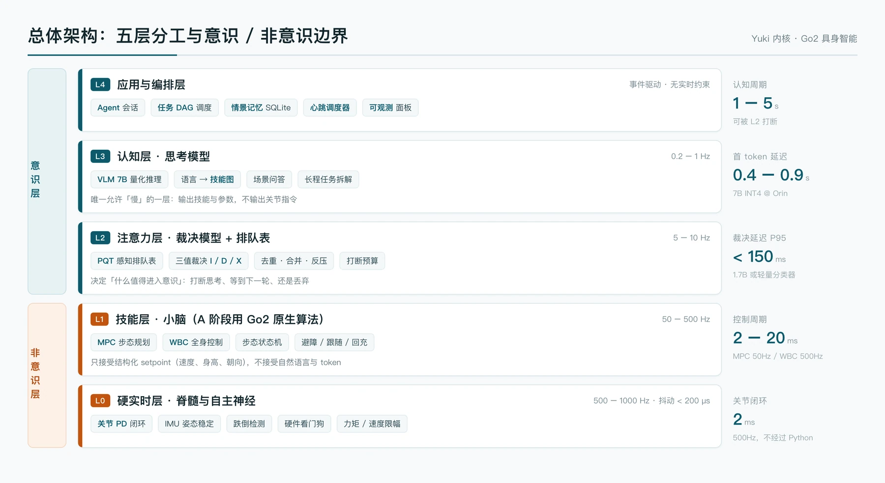
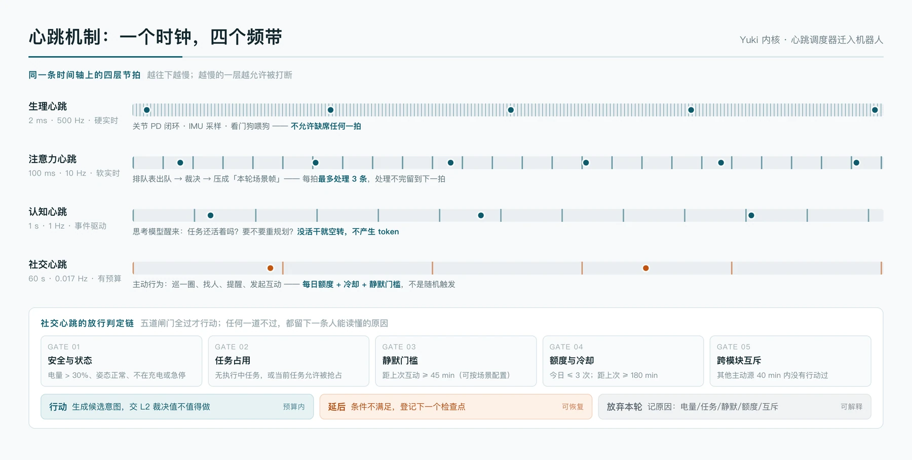
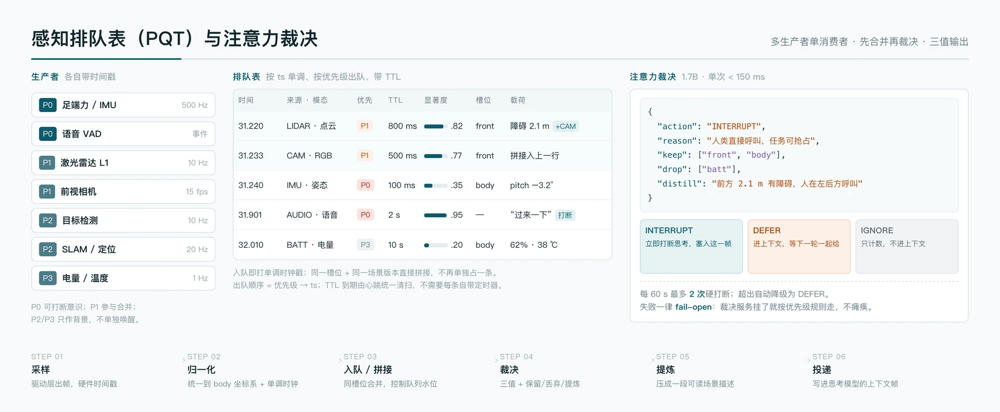
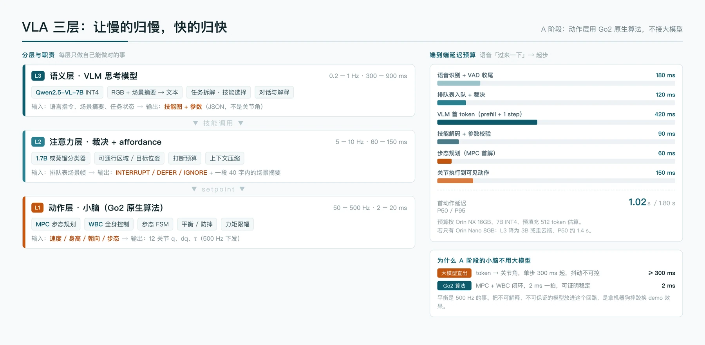
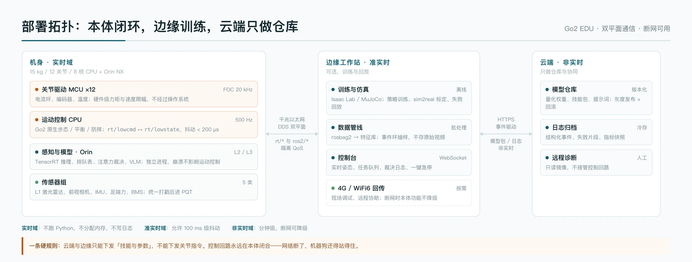
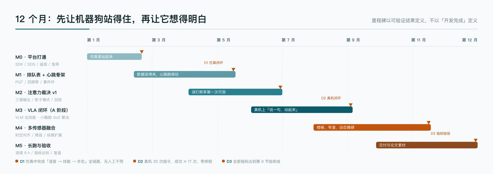

*基于 Yuki 内核、心跳调度与 VLA 三层的技术方案 · v1.0 · 2026-10-30*

## 摘要

本方案把已经在对话智能体上跑通的 [Yuki 内核](/projects/yuki/) 迁移到宇树 Go2 四足机器人，做一套模块化的具身智能系统。核心是三件事：

- 用心跳把不同频率的行为统一到一个时钟上，让"主动"变成可预算、可解释、可关闭的调度问题。
- 用排队表把多传感器异步数据收敛成带优先级和时间戳的条目，逐条消费，不把原始数据直接灌给模型。
- 用注意力模型决定每条数据是打断思考、排队等下一轮，还是丢弃。

VLA 分三层：语义层慢（0.2–1 Hz），注意力层中速（5–10 Hz），动作层 500 Hz。A 阶段的动作层直接用 Go2 原生步态与平衡算法，不接大模型。目标是语音指令到起步动作 P50 ≤ 1.2 s，同时保证控制环抖动 P99 < 200 μs。

| 维度 | 目标值 |
|---|---|
| 端到端首动作延迟 | P50 ≤ 1.2 s，P95 ≤ 1.8 s |
| 控制环抖动 | P99 < 200 μs @ 500 Hz |
| 指令意图准确率 | ≥ 92%（60 条指令集） |
| 注意力误打断率 | ≤ 8%（200 个标注场景） |
| 连续运行 | 8 h 无重启 |
| 功耗增量 | ≤ 20 W（相对原生运动） |

## 1 项目定义

### 1.1 背景

四足机器人已经能走、能跑、能爬楼梯。宇树 Go2 把这件事做到了消费级价格：12 个关节、单关节峰值扭矩 45 N·m、4D 激光雷达 L1（360°×90°）、前视 1280×720 广角相机、IMU、足端力传感器，EDU 版还带 Jetson Orin 模组。

能走不等于会做事。把大模型接上去做指令理解，demo 很好看，落到实际使用就出问题：模型说"往前走一点"，机器狗已经撞上桌腿；模型在 500 ms 后才回一句"好的"，人早走了。问题不在模型不够聪明，在于**感知、决策、控制三个时间尺度被塞进了同一条链路**。

### 1.2 现有做法的三个断点

**断点一：所有数据都往上下文里灌。**
相机 30 fps、雷达 10 Hz、IMU 500 Hz。全塞给模型，token 爆炸；只给最后一帧，又丢掉了"刚才发生了什么"。缺一个中间层来决定什么值得留下。

**断点二：决策和控制绑在一起。**
大模型输出关节角，或者输出一段代码去控制关节。前者不可解释、不可保证稳定；后者延迟高、错误无法收敛。平衡是 2 ms 的事，规划是 1 s 的事，两者必须分开。

**断点三：智能体只会应答，不会主动。**
人不说，它就不动。真实场景里需要它自己巡一圈、发现异常、回来提醒。主动行为一旦写成"定时随机触发"，就会在不该动的时候动，在该动的时候不动。

### 1.3 本项目做什么

- 把 Yuki 内核的四项机制迁到机器人：心跳调度、内在状态总线、注意力裁决、事件环。
- 实现一套感知排队表，作为多传感器与模型之间的唯一入口。
- 实现 VLA 三层，明确每层的输入输出、频率和失败模式。
- A 阶段动作层用 Go2 原生算法，给出可验证的延迟与稳定性指标。
- 给出 B 阶段的演进路径（RL 策略 + action expert），以及安全兜底。

### 1.4 本项目不做什么

- 不做端到端训练一个"大模型直接输出关节"的系统。
- 不做机械臂操作，任务范围限定在移动、观察、交互。
- 不追求开放世界通用智能，场景限定在室内与园区。

## 2 设计原则

**一、慢的归慢，快的归快。**
每层只做自己能做对的事。语义层不碰电机，动作层不读自然语言。

**二、先量，再改。**
任何"看起来能提升体验"的改动，先在影子模式跑一周、拿真实数据回放，再决定是否生效。这条来自内核的教训：识图等待优化按分组算能省 81%，实测只省 15%。

**三、模型只做感知，阈值写进代码。**
让模型回答"有没有人叫它""前方是否可通行"这类事实判断题，比让它直接输出"该不该动"稳定得多。组合逻辑和阈值放在代码里，可测、可回滚。

**四、失败即中性。**
裁决服务超时、模型返回空、队列写失败——都按"没判断"处理，继续走默认路径。宁可多动一次，不能因为一个组件挂了整机瘫痪。

**五、每条"没做"都要有原因。**
心跳没触发、注意力没打断、任务没执行，都要留下一条人能读懂的原因。这是调参与排障的唯一线索。

## 3 总体架构

### 3.1 五层分工



| 层 | 名称 | 频率 | 职责 | 典型实现 |
|---|---|---|---|---|
| L4 | 应用与编排 | 事件驱动 | 会话、任务 DAG、记忆、心跳调度 | Python asyncio + SQLite |
| L3 | 认知层 | 0.2–1 Hz | 语言理解、任务拆解、技能选择 | VLM 7B（INT4） |
| L2 | 注意力层 | 5–10 Hz | 排队表消费、三值裁决、场景提炼 | 1.7B 模型 + 规则 |
| L1 | 技能层（小脑） | 50–500 Hz | 步态、平衡、避障、技能执行 | MPC + WBC + 步态 FSM |
| L0 | 硬实时层 | 500–1000 Hz | 关节闭环、姿态稳定、看门狗 | C++ / MCU |

层与层之间只有两种东西可以传：**结构化 setpoint** 和 **文本**。没有中间态，没有共享内存乱穿。

### 3.2 意识与非意识的边界

人的交感神经不管"要不要抬左手"，它管心率、瞳孔、血管收缩。这些功能一直在跑，不需要意识批准，也不能被意识直接改写。

机器人要照这个结构分：

**非意识层**（L0、L1 的下半部分）
- 姿态平衡、步态相位、落脚点选择、跌倒保护、关节限幅、看门狗
- 不产生语义，不进上下文，不被自然语言指令直接改写
- 判断标准：**任何被中断后 200 ms 内无法安全恢复的动作，必须放在这一层**

**意识层**（L2、L3、L4）
- 注意力、任务规划、对话、主动行为
- 有目标、可选择、可解释
- 可以被抢占，抢占的代价是任务重规划，不是摔倒

这条边界决定了系统能不能安全地接入大模型。把平衡放进意识层，等于让人用思考维持站立——理论上可行，工程上不可靠。

### 3.3 控制面与数据面

系统内部跑两套通信：

| 平面 | 承载 | 协议 | 要求 |
|---|---|---|---|
| 控制面 | 关节指令、状态回传、安全信号 | CycloneDDS（`rt/lowcmd`、`rt/lowstate`、`rt/sportmodestate`） | 500 Hz，抖动 < 200 μs，best-effort |
| 数据面 | 点云、图像、检测结果、任务事件 | ROS 2（Humble）+ 共享内存 | 10–30 Hz，允许 50 ms 抖动 |

控制面不经过 ROS 2。ROS 2 的 executor 调度、序列化、DDS 发现机制都会引入不可控的抖动。Go2 原生就是 DDS，直接用 `unitree_sdk2` 订阅 `rt/lowstate`、发布 `rt/lowcmd`，路径最短。

数据面用 ROS 2 是为了工具链：rviz、rosbag2、tf2、点云滤波、Nav2 的代价地图，这些不值得自己写。

### 3.4 为什么 A 阶段的小脑不用大模型

| 路径 | 单步延迟 | 抖动 | 可证明性 |
|---|---|---|---|
| 大模型直接输出关节 | ≥ 300 ms | 受 batch、显存、温度影响，方差大 | 无 |
| MPC + WBC 闭环 | 2–20 ms | 确定性，可测 | 有（约束满足、稳定性判据） |

500 Hz 的回路里放一个 300 ms 起步、方差不可控的组件，等于把摔倒概率交给运气。A 阶段的动作层完全用 Go2 原生算法，大模型只负责"选哪个技能、给什么参数"。

B 阶段可以引入 RL 策略（Isaac Lab 训练、sim2real 部署），仍然保留 Go2 算法作为安全通道：策略输出经过一层仲裁，超出安全包络就切回 MPC。

## 4 Yuki 内核与心跳

### 4.1 内核是什么

Yuki 内核原本是跑在对话机器人上的一套智能体框架，由 60 多个插件组成，解决的是同一类问题：多个异步信号源、有限的处理预算、需要主动行为、需要可解释。

它沉淀了四项可迁移的机制：

| 机制 | 解决的问题 | 迁移到机器人的形态 |
|---|---|---|
| 心跳调度 | 主动行为何时发生、发生几次 | 四频带节拍 + 五道闸门 |
| 内在状态总线 | N×M 点对点读取导致状态互相矛盾 | 统一状态快照，单次聚合 |
| 注意力裁决 | 什么消息值得回复 | 什么数据值得进入意识 |
| 事件环 | 明细太多不能常驻上下文 | 索引常驻 + 明细懒加载 |

### 4.2 概念映射

| 内核概念 | 对话场景 | Go2 场景 |
|---|---|---|
| 心跳 | 冷场够久就说一句 | 静默够久就巡一圈 / 发起互动 |
| 事件环 | 群消息、撤回 | 传感器帧、检测事件、异常 |
| 内在状态 | 情绪、欲望、疲劳、社交距离 | 姿态、电量、任务、安全等级 |
| 注意力裁决 | 这条消息要不要接 | 这帧数据要不要打断当前任务 |
| 思考模型 | LLM 组织回复 | VLM 拆任务、选技能 |
| 注入块 | 上下文片段 | 场景帧 |
| 影子模式 | 只判定不执行 | 只裁决不打断，记录日志 |

### 4.3 心跳的四个频带



一颗心跳承担全部节拍。每个 tick 只回答一个问题：现在该不该做事。四个定时器各自为政的写法，迟早会在互斥上出问题。

| 频带 | 周期 | 承载 | 缺席后果 |
|---|---|---|---|
| 生理心跳 | 2 ms | 关节 PD、IMU 采样、喂狗 | 立即停机（看门狗 200 ms 超时） |
| 注意力心跳 | 100 ms | 排队表出队、裁决、场景帧 | 感知延迟上升，不致命 |
| 认知心跳 | 1 s | 检查任务是否存活、是否重规划 | 任务卡住，可恢复 |
| 社交心跳 | 60 s | 主动行为判定 | 不主动，功能降级 |

生理心跳由 L0 的实时线程自己维护，不走 Python 的事件循环。注意力心跳以上跑在 asyncio 里，允许几十毫秒的抖动。

### 4.4 心跳的调度语义

社交心跳沿用内核的五道闸门：

| 闸门 | 判据 | 不过时记的原因 |
|---|---|---|
| G1 安全与状态 | 电量 > 30%、姿态正常、不在充电或急停 | `low_battery` / `bad_attitude` / `charging` / `estop` |
| G2 任务占用 | 无执行中任务，或任务可抢占 | `task_running` |
| G3 静默门槛 | 距上次互动 ≥ 45 min | `still_hot` |
| G4 额度与冷却 | 今日 ≤ 3 次，距上次 ≥ 180 min | `quota_used` / `cooling` |
| G5 跨模块互斥 | 其他主动源 40 min 内没行动 | `other_source_spoke` |

五道全过才产生一个候选意图。候选意图不直接执行，要交给 L2 裁决值不值得做——这一步防止"条件都满足但时机不对"。

配置项：

| 参数 | 默认 | 说明 |
|---|---|---|
| `hb_tick_ms` | 100 | 注意力心跳周期 |
| `hb_idle_minutes` | 45 | 静默门槛 |
| `hb_day_max` | 3 | 每日主动次数 |
| `hb_cooldown_minutes` | 180 | 冷却时长 |
| `hb_cross_cooldown_s` | 2400 | 跨模块互斥窗口 |
| `hb_active_hours` | 8-22 | 允许时段 |
| `hb_interrupt_budget` | 2 / 60 s | 打断预算 |


心跳循环的实现骨架：

```python
async def heartbeat(self):
    while not self.stopped:
        await asyncio.sleep(self.tick_ms / 1000)
        if not self.enabled:
            continue
        try:
            verdict = self.evaluate()            # 纯函数，只读状态快照
            if verdict.action == "skip":
                self.log_skip(verdict)           # 每轮一行，原因可读
                continue
            intent = self.propose(verdict)       # 候选意图，不直接执行
            if await self.arbitrate(intent):     # 交给 L2 再判一次
                await self.dispatch(intent)
                self.state.spend(intent.cost)    # 扣额度、记冷却
        except Exception as exc:
            self.log.warning("heartbeat round failed: %s", exc)
            await asyncio.sleep(self.backoff_s)
```

`evaluate()` 不碰网络、不碰模型，只读一份不可变的状态快照。这样即使裁决服务挂了，心跳仍在跑，只是所有候选意图都被 `arbitrate` 拒掉。

### 4.5 主动行为怎么产生

候选意图从状态快照里长出来，链路是：

```
社交心跳 tick
  → 读内在状态快照（电量、姿态、任务、位置、上次互动时间）
  → 过五道闸门
  → 产生候选意图（巡逻 / 靠近 / 提醒 / 叫唤 / 回充）
  → 交给 L2 裁决：现在做值不值得
  → 通过则生成技能调用，进任务 DAG
  → 执行结果写回状态，更新冷却与额度
```

候选意图有优先级，也有互斥：正在执行 `patrol` 时不会再产生 `approach`。

### 4.6 可解释性

每次心跳结束写一行结构化日志：

```json
{"ts":"2026-10-30T14:02:11.412+08:00","beat":"social","result":"skip",
 "reason":"still_hot","idle_min":12,"threshold":45,"quota":"2/3","battery":71}
```

排查"为什么它一直不动"时，看这一行就够。这条设计直接来自内核的教训：日志级别调成 debug 等于没有日志。

## 5 注意力决策模型与排队表

### 5.1 为什么需要排队表

三路数据同时到达：

- 雷达在 31.220 s 报"前方 2.1 m 有障碍"
- 相机在 31.233 s 报"那是个蹲着的人"
- 语音在 31.900 s 说"过来一下"

如果每条都触发一次模型调用，1 秒内三次，延迟叠加，token 翻倍，而且模型看到的是三段割裂的描述，判断质量反而下降。

如果只取最新一条，会丢掉"障碍物是人"这个关键信息。

排队表要解决的就是这个：**先把异步数据收敛成有序、可合并、可丢弃的条目，再按节奏逐条消费。**

### 5.2 数据结构



| 字段 | 类型 | 说明 |
|---|---|---|
| `id` | uint64 | 单调递增 |
| `ts` | int64 | 单调时钟，纳秒 |
| `source` | enum | lidar / camera / imu / audio / detector / task / bms |
| `modality` | enum | pointcloud / rgb / pose / text / scalar |
| `priority` | uint8 | P0 可打断，P1 参与合并，P2/P3 背景 |
| `ttl_ms` | uint32 | 到期由心跳统一清扫 |
| `salience` | float | 0–1，显著度，模型或规则给 |
| `slot` | string | 空间/语义槽位（front / body / left / task） |
| `payload_ref` | shm_ref | 共享内存偏移，不拷贝大对象 |
| `provenance` | list | 合并了哪些来源，保留原始值 |
| `fingerprint` | uint64 | 去重用（source + 几何位置 + 语义标签） |

队列本体是一个带时间戳的最小堆，按 `(priority desc, ts asc)` 出队。TTL 到期不立刻删除，只打墓碑标记，出队时跳过——堆里做删除的代价比惰性清理高。容量 512 条，水位超过 80% 触发反压。

### 5.3 写入、拼接与合并

**写入**：每个生产者只写自己的数据，不读别人的。入队前做三件事——打单调时间戳、转到 body 坐标系、算指纹。

**拼接（splice）**：同一 `slot` 且时间窗在 300 ms 内的条目直接合并到已有条目，不新增。

```
31.220  { slot: front, type: obstacle, dist: 2.1, conf: 0.81 }
31.233  { slot: front, type: human,    bbox: [...], conf: 0.93 }
        ↓ splice
31.233  { slot: front, type: human, dist: 2.1, conf: 0.93,
          provenance: [lidar@31.220, camera@31.233] }
```

拼接规则：
- 先到者建槽，后到者按 `(slot, ttl)` 合并。
- 冲突时高优先级源覆盖低优先级源，但两方原始值都保进 `provenance`。
- 每槽最多 4 个来源，超出替换最旧的，防止无限膨胀。

**合并（coalesce）**：指纹相同的条目只保留最新一条，计数加一。IMU 这类高频数据不进队列明细，只写统计量（姿态角、角速度方差、冲击标志）。

**丢弃**：TTL 到期、水位超限且 salience 低、被注意力判为 IGNORE 且超过保留窗口。

### 5.4 三值裁决

注意力模型每拍取 1–3 条（按优先级），输出三选一：

| 动作 | 含义 | 后果 |
|---|---|---|
| `INTERRUPT` | 立即打断思考模型，塞入这一帧 | 当前推理被抢占，上下文插入场景帧 |
| `DEFER` | 进待处理区，等下一轮一起给 | 不打断，合并进下一次思考的输入 |
| `IGNORE` | 只计数，不进上下文 | 写事件环，供事后回放 |

输出 schema：

```json
{
  "action": "INTERRUPT",
  "salience": 0.95,
  "reason": "人类直接呼叫，当前任务可抢占",
  "keep_slots": ["front", "body"],
  "drop_slots": ["bms"],
  "distill": "前方 2.1 m 有一人蹲着，人在左后方呼叫"
}
```

`distill` 控制在 40 字内。原始点云止步于 L2，进不了思考模型的上下文。

### 5.5 判据设计：模型只做感知，阈值写代码

这是整个方案里最重要的一条工程决策，来自内核四次迭代的教训：让模型直接输出"该不该说话"，同一个模型、同一批场景，只改措辞，判沉默率在 0% 和 62% 之间乱跳。

改成让模型回答几个事实判断题，稳定性立刻上来：

| 感知量 | 类型 | 用途 |
|---|---|---|
| `human_addressing` | bool | 有人在对它说话 |
| `safety_critical` | bool | 跌倒、碰撞、越界、低电 |
| `task_relevant` | bool | 与当前任务目标相关 |
| `novelty` | float | 与最近 30 s 场景的差异度 |
| `occlusion_risk` | bool | 关键区域被遮挡 |
| `distill` | string | ≤ 40 字场景摘要 |

代码侧的硬规则（不问模型）：

1. 安全事件 → 直接 `INTERRUPT`，跳过模型。
2. 人类直接呼叫（唤醒词或持续朝向 + VAD）→ 提升到 P0。
3. 当前任务不可抢占 → 默认 `DEFER`，除非安全事件。
4. 60 s 内已打断 2 次 → 强制降级为 `DEFER`。
5. 同 slot 同指纹 5 s 内重复 → 合并，不重复裁决。


裁决逻辑写成纯函数，模型只提供事实：

```python
def judge(frame, ctx) -> Verdict:
    # 1. 硬规则，不问模型
    if frame.safety_critical:
        return Verdict("INTERRUPT", 1.0, "safety")
    if ctx.interrupt_spent >= ctx.budget:
        return Verdict("DEFER", frame.salience, "budget_exhausted")
    if not ctx.preemptible:
        return Verdict("DEFER", frame.salience, "task_protected")

    # 2. 模型只给事实，不给结论
    facts = model.perceive(frame)          # 6 个布尔量或分数
    if facts.human_addressing:
        return Verdict("INTERRUPT", 0.95, "human_call")

    # 3. 组合逻辑写在代码里，可测、可回滚
    if facts.novelty < 0.3 and not facts.task_relevant:
        return Verdict("IGNORE", facts.novelty, "stale")
    if facts.task_relevant and facts.novelty >= 0.5:
        return Verdict("DEFER", facts.novelty, "task_update")
    return Verdict("IGNORE", facts.novelty, "background")
```

改判断倾向时只改这几行，不用重新调提示词，也不用重跑模型。

### 5.6 失败与降级

| 故障 | 行为 |
|---|---|
| 裁决模型超时（> 200 ms） | 按优先级规则走，P0 打断，其余 DEFER |
| 模型返回无法解析 | 同上，并计数 |
| 连续失败 5 次 | 熔断 5 min，只走规则 |
| 队列写满 | 丢 P2/P3，保留 P0/P1，记 `queue_overflow` |
| 共享内存分配失败 | 降级为拷贝模式，记警告 |

### 5.7 一次完整裁决的时序

```
t=0     麦克风 VAD 检测到语音，唤醒词命中
t=8ms   音频特征入队，priority=P0，slot=audio
t=100ms 注意力心跳触发，取队首
t=118ms 规则命中"人类直接呼叫"，跳过模型
t=121ms 发 INTERRUPT，当前 VLM 推理被取消
t=380ms ASR 完成，文本"过来一下"入队
t=400ms 场景帧组装：{人声, 前方行人, 当前位姿, 任务状态}
t=402ms 投递给思考模型
t=820ms VLM 返回技能调用 move_to(target=human, distance=1.5)
t=850ms 参数校验通过，下发 setpoint
t=910ms MPC 首解完成，步态切换
t=1.02s 可见动作开始
```

## 6 VLA 三层

### 6.1 分层与接口



| 层 | 输入 | 输出 | 频率 | 失败模式 |
|---|---|---|---|---|
| L3 语义 | 语言、场景摘要、任务状态 | 技能图（JSON） | 0.2–1 Hz | 输出非法技能 → 参数校验拒绝 |
| L2 注意力 | 排队表条目 | 三值裁决 + 场景帧 | 5–10 Hz | 超时 → 规则兜底 |
| L1 动作 | setpoint（速度/身高/朝向/步态） | 12 关节 q/dq/τ | 50–500 Hz | 超限 → 限幅 + 阻尼 |

层间契约用 JSON Schema 固定，任何一侧改字段都要走版本号。

### 6.2 L3 语义层

模型：Qwen2.5-VL-7B-Instruct，AWQ INT4 量化，约 5.2 GB 显存。

输入：
- 系统提示（能力边界、安全规则、输出格式）
- 最近 3 帧场景摘要（不是原始图像）
- 当前任务 DAG 的剩余部分
- 用户指令文本

输出：

```json
{
  "plan": [
    {"skill": "move_to", "args": {"target": "human_0", "distance": 1.5, "speed": 0.6}},
    {"skill": "look_at", "args": {"target": "human_0"}}
  ],
  "say": "来了",
  "abort_condition": "human_0 消失超过 3 s"
}
```

约束：
- 只能调用技能白名单里的 10 个原语（见 6.5）。
- 参数有范围校验，超范围直接拒绝，不重试。
- 输出必须是合法 JSON，解析失败回退到"确认型"默认回复，不下发动作。

### 6.3 L2 注意力层

模型：Qwen3-1.7B-Instruct INT4（约 1.2 GB），或蒸馏的 0.6B 分类头。实测 1.7B 在 Orin NX 上单次裁决 80–140 ms。

它同时承担两个职责：
- 裁决（5.4 节）
- affordance 提取：把场景压成"哪里能走、目标在哪、距离多少"，供 L3 使用

为什么不让 L3 直接看原图：一张 1280×720 的图在 7B 模型里是 1000+ token，每帧都传，prefill 时间就吃掉全部预算。L2 把它压成 40 字 + 几个结构化字段，L3 只在需要时请求原图。

### 6.4 L1 动作层（A 阶段）

组成：

| 模块 | 频率 | 作用 |
|---|---|---|
| 步态状态机 | 50 Hz | 站立 / 小跑 / 爬坡 / 上下楼梯 / 坐下 |
| MPC | 50 Hz | 预测 0.5 s 的落脚点与质心轨迹 |
| WBC | 500 Hz | 全身控制，把任务空间目标解算成关节力矩 |
| 关节 PD | 500 Hz | `LowCmd` 下发，kp/kd 随步态切换 |
| 安全监督 | 1 kHz | 限幅、跌倒检测、看门狗 |

输入接口（setpoint）：

```json
{"vx": 0.6, "vy": 0.0, "vyaw": 0.2, "height": 0.30,
 "gait": "trot", "stance_width": 0.22, "deadline_ms": 200}
```

动作层只认这几个量。"走过去"这类语义在技能原语里就翻译完了。

### 6.5 技能原语

| 技能 | 参数 | 前置条件 | 退出条件 |
|---|---|---|---|
| `move_to` | target, distance, speed | 定位有效 | 到达 ±0.3 m 或超时 |
| `follow` | target_id, distance | 目标可见 | 目标丢失 3 s |
| `look_at` | target | — | 朝向误差 < 5° |
| `patrol` | waypoints[] | 地图有效 | 走完一圈或低电 |
| `explore` | area_id, duration | 地图有效 | 时间到或遇障 |
| `stair` | direction | 楼梯检测命中 | 到平台且姿态稳定 |
| `back_off` | distance | 后方净空 | 距离达到 |
| `sit` / `stand` | — | 静止 | 姿态到位 |
| `dock` | — | 充电桩可见 | 对接成功 |
| `stop` | — | — | 立即（最高优先级） |

每个技能都有超时、可抢占标记和失败回调。`stop` 永远可抢占，其余按优先级。

### 6.6 B 阶段演进

A 阶段跑通后，动作层按两条线升级：

**第一条：RL 策略替换部分步态。**
Isaac Lab 训练 locomotion policy，观测包括 IMU、关节状态、足端力、地形高度图，动作是 12 维关节目标。部署时用 ONNX Runtime，10 kHz 推理在 Orin 上可行。保留 MPC 作为安全通道，策略输出超出包络就切换。

**第二条：动作专家（action expert）。**
参考 π0 的做法，用一个 300M 级别的 flow matching 头，接收 L2 的视觉特征与 L3 的技能嵌入，输出 50 Hz 的动作块（action chunk）。这一层仍然不直接驱动关节，输出的是 setpoint 序列。

两条线的共同前提：A 阶段的指标全部达标，且安全兜底经过至少 100 h 真机验证。

### 6.7 安全约束如何贯穿三层

| 层 | 约束 | 实现 |
|---|---|---|
| L3 | 只能选白名单技能 | JSON Schema + 枚举校验 |
| L3 | 参数范围 | 每技能定义 min/max，超限拒绝 |
| L2 | 打断预算 | 令牌桶，60 s 2 次 |
| L2 | 不可抢占任务保护 | 任务标记 `preemptible: false` |
| L1 | 速度/力矩限幅 | 硬编码上限，配置只能调低 |
| L1 | 姿态保护 | roll/pitch > 45° 触发阻尼 |
| L0 | 看门狗 | 200 ms 无心跳 → 电机阻尼 |
| 硬件 | 急停 | 遥控器 + 物理断电 |

任何一层的软件崩溃，都不能让机器狗失去平衡。这是硬约束。

## 7 多传感器协同

### 7.1 Go2 传感器清单

| 传感器 | 型号/规格 | 原始频率 | 入队频率 | 用途 |
|---|---|---|---|---|
| 4D 激光雷达 | L1，360°×90° | 10 Hz | 10 Hz | 障碍、地形、定位 |
| 前视相机 | 1280×720，120° FOV | 30 fps | 15 fps | 检测、识别、视觉伺服 |
| IMU | 三轴加速度 + 角速度 | 500 Hz | 200 Hz（统计量） | 姿态、冲击检测 |
| 足端力 | 四足，EDU 版 | 500 Hz | 100 Hz（统计量） | 接触检测、打滑判断 |
| 关节编码器 | 12 关节 | 500 Hz | 50 Hz | 状态监控 |
| BMS | 电压/电流/温度 | 1 Hz | 1 Hz | 电量、热管理 |
| 麦克风阵列 | 机身内置 | 16 kHz | 事件 | 唤醒、方向 |

### 7.2 时间同步

三个时钟源要对齐：

- **硬件时钟**：雷达和相机各自带硬件时间戳，驱动层直接读，不用软件时间。
- **单调时钟**：所有入队条目用 `CLOCK_MONOTONIC`，避免系统时间跳变导致 TTL 计算错乱。
- **跨设备对齐**：Orin 与控制 CPU 之间用 PTP（IEEE 1588）对齐，实测偏差 < 1 ms。相机与雷达的外参标定同时记录时间偏移，融合时补偿。

时间戳误差超过 50 ms 的条目直接丢弃，不参与拼接——错时的融合比不融合更糟。

### 7.3 空间对齐

所有数据统一到 `body` 坐标系（机身几何中心，x 向前，y 向左，z 向上）。

- 雷达到 body：出厂外参 + 现场标定（平面拟合 + 已知尺寸标定板），平移误差 < 1 cm，旋转 < 0.5°。
- 相机到 body：棋盘格标定，重投影误差 < 0.5 px。
- 足端到 body：正运动学实时算，随关节角变化。

外参存 YAML，带版本号和标定日期。改了外参必须重跑回放验证，不能直接上线。

### 7.4 三级融合

| 级别 | 内容 | 位置 | 延迟 |
|---|---|---|---|
| 原始级 | 点云 + 图像 + IMU 的时间对齐与坐标变换 | 驱动层 | < 5 ms |
| 特征级 | 障碍栅格、可通行区域、检测框、目标轨迹 | L2 | 30–80 ms |
| 语义级 | "前方有人蹲着，左侧可绕行" | L2 → L3 | 100–150 ms |

三级融合的分工：原始级保证不错时，特征级保证不漏检，语义级保证模型看得懂。

### 7.5 降级策略

| 故障 | 检测方式 | 降级行为 | 恢复 |
|---|---|---|---|
| 雷达掉线 | 200 ms 无帧 | 速度上限 0.3 m/s，仅视觉避障 | 自动重连，连续 10 帧正常后恢复 |
| 相机掉线 | 500 ms 无帧 | 停止视觉类技能，保留运动 | 同上 |
| IMU 异常 | 方差超阈值 / 数据冻结 | 立即阻尼趴下 | 人工确认 |
| 足端力异常 | 四足全零或全满 | 切换盲走步态，降速 | 自检通过后恢复 |
| Orin 崩溃 | 心跳丢失 1 s | 运动控制保持，agent 由 systemd 拉起 | 自动 |
| 网络断开 | 5 s 无心跳包 | 本地模式，禁用云端技能 | 自动 |
| 电量 < 15% | BMS | 拒绝新任务，触发回充 | 充电后恢复 |
| 队列积压 | 水位 > 80% | 丢 P2/P3，降采样 | 水位 < 50% |

## 8 技术栈



### 8.1 硬件与算力分档

| 配置 | 算力 | 能跑什么 | 端到端延迟 |
|---|---|---|---|
| Go2 EDU + Orin Nano 8GB | 40 TOPS | L2 1.7B + L3 3B（INT4） | P50 ≈ 1.4 s |
| Go2 EDU + Orin NX 16GB | 100 TOPS | L2 1.7B + L3 7B（INT4） | P50 ≈ 1.0 s |
| 外挂工作站（WiFi6） | RTX 4060 以上 | L3 走 14B，可多帧推理 | 受网络影响，1.5–2.5 s |

方案默认按 Orin NX 16GB 设计，其他两档通过配置切换模型规格。

### 8.2 软件栈

| 层 | 选型 | 版本 | 理由 |
|---|---|---|---|
| OS | Ubuntu 22.04 + JetPack 6 | — | Orin 官方支持，ROS 2 Humble 匹配 |
| 内核 | PREEMPT_RT 补丁 | 5.15 | 控制线程抖动从 ms 级降到 μs 级 |
| 机器人 SDK | unitree_sdk2 / unitree_sdk2py | latest | 官方 DDS 接口，路径最短 |
| 中间件 | CycloneDDS + ROS 2 Humble | — | 控制面裸 DDS，数据面 ROS 2 |
| 控制 | C++17 + Eigen + Pinocchio + OSQP | — | MPC/WBC 的标准组合 |
| 感知 | PCL + OpenCV + TensorRT | 10.x | 点云、图像、推理 |
| 模型服务 | TensorRT-LLM / llama.cpp | — | INT4 量化推理 |
| 内核 | Python 3.11 + asyncio + pydantic v2 | — | 迭代速度，与现有内核同构 |
| 存储 | SQLite（WAL）+ 共享内存 | 3.45 | 单机零依赖，崩溃恢复简单 |
| 观测 | Prometheus + Grafana + rosbag2 | — | 指标、回放 |
| 仿真 | MuJoCo 3.2 + unitree_mujoco | — | 快速验证；B 阶段上 Isaac Lab |

### 8.3 模型清单

| 用途 | 模型 | 参数 | 量化 | 显存 | 延迟 |
|---|---|---|---|---|---|
| 任务规划 | Qwen2.5-VL-7B-Instruct | 7B | AWQ INT4 | 5.2 GB | 首 token 420 ms |
| 注意力裁决 | Qwen3-1.7B-Instruct | 1.7B | INT4 | 1.2 GB | 80–140 ms |
| 目标检测 | YOLOv8n / RT-DETR-R18 | 3–20M | INT8 | 0.3 GB | 12–25 ms |
| 图像嵌入 | SigLIP-SO400M | 0.4B | FP16 | 0.8 GB | 30 ms |
| 语音识别 | FunASR Paraformer / Whisper-base | 0.2B | INT8 | 0.4 GB | 180 ms（含 VAD 收尾） |
| 语音合成 | 轻量 TTS（可选） | — | — | 0.2 GB | 实时 |

显存合计约 8 GB，Orin NX 16GB 有一半余量给系统和其他进程。

### 8.4 关键选型说明

**为什么控制面不用 ROS 2。**
ROS 2 的 executor 会在回调之间做调度，DDS 序列化也有开销。500 Hz 下每 2 ms 一次，任何一次调度抖动都会体现在关节上。裸 DDS 点对点，路径上只有序列化和网络。

**为什么存储用 SQLite 不用 Redis。**
单机、单写者、事件量 1 万条/秒以内，SQLite WAL 完全够。Redis 要多一个进程、多一份内存、多一种崩溃模式。事件环要的是可查询的历史。

**为什么内核用 Python。**
心跳、裁决编排、任务 DAG 这些逻辑变更频繁，Python 的迭代速度值这个开销。控制回路不碰 Python，GC 停顿影响不到电机。

**为什么动作层不直接用 RL 策略。**
A 阶段的目标是把系统跑通、把指标量出来。RL 策略的 sim2real 需要大量调参和真机时间，放在 B 阶段做，有 A 阶段的安全通道兜底。

## 9 指标与验证

### 9.1 指标表

| 类别 | 指标 | 目标 | 测法 |
|---|---|---|---|
| 实时 | 控制环抖动 P99 | < 200 μs | 连续 8 h 打点，cyclictest 对照 |
| 实时 | 控制指令丢失率 | < 0.01% | DDS 计数对比 |
| 延迟 | 首动作 P50 / P95 | ≤ 1.2 s / 1.8 s | 50 次语音指令，高速相机计时 |
| 延迟 | 注意力裁决 P95 | < 150 ms | 单测 + 线上采样 |
| 认知 | 意图准确率 | ≥ 92% | 60 条指令，3 人各 20 条 |
| 认知 | 任务完成率 | ≥ 85% | 5 类场景各 20 次 |
| 注意力 | 误打断率 | ≤ 8% | 200 个标注场景回放 |
| 注意力 | 漏打断率 | ≤ 12% | 同上 |
| 运动 | 静态站立 10 min 漂移 | ≤ 3 cm | 激光跟踪仪 |
| 运动 | 侧向 40 N 冲击恢复 | ≤ 0.6 s，位移 ≤ 12 cm | 摆锤实验，10 次 |
| 运动 | 16 cm 台阶成功率 | ≥ 95% | 30 次上下 |
| 系统 | 连续运行 | 8 h 无重启 | 长跑脚本 + 日志审计 |
| 系统 | 功耗增量 | ≤ 20 W | 功率计对比原生模式 |
| 交互 | 主动行为采纳率 | ≥ 60% | 人工标注 50 次主动行为 |

### 9.2 测试方法

**分层测试。** 每层有独立的测试台：
- L0/L1：MuJoCo 仿真 + 真机台架，跑阶跃响应、扰动恢复、极限姿态。
- L2：离线回放。把真机录制的 rosbag 灌进裁决模块，人工标注 200 个场景做混淆矩阵。
- L3：指令集测试。60 条指令覆盖 10 个技能，每条跑 3 次，记录解析成功率与参数正确率。

**影子模式。** 新版本先只裁决不执行，跑一周，对比"如果执行会怎样"和"实际发生了什么"。内核的经验是，这一步能挡掉大部分想当然的优化。

**对抗测试。** 故意制造：突然出现的人、强光、地面反光、WiFi 拥塞、电量骤降、传感器拔线。记录降级是否按预期发生。

### 9.3 数据与回放

- 全量 rosbag2 存 7 天，之后只保留事件片段（失败、打断、人工标注）。
- 事件环存结构化摘要，不存原始视频。一是存储，二是隐私。
- 回放工具支持"改一个参数，重跑同一段数据"，用于对比裁决策略。

## 10 里程碑



| 阶段 | 时间 | 交付物 | 验收标准 |
|---|---|---|---|
| M0 平台打通 | 第 1 月 | SDK 封装、DDS 桥、遥测面板、急停链路 | 仿真里站立、行走、遥测 10 Hz 刷新 |
| M1 排队表与心跳 | 第 2–3 月 | PQT、四频带调度、事件环 | 仿真中语音→技能→步态全链路，无人工干预 |
| M2 注意力裁决 | 第 3–4 月 | 三值裁决、影子模式、回放工具 | 200 场景回放，误打断率可测 |
| M3 VLA 闭环 | 第 5–6 月 | L3 技能调用、L1 执行、参数校验 | 真机 20 次指令成功 ≥ 17 次，零摔倒 |
| M4 多传感器融合 | 第 7–9 月 | 时空对齐、三级融合、降级 | 楼梯、窄道、动态障碍各 20 次 |
| M5 长跑与验收 | 第 10–12 月 | 指标报告、论文素材、演示 | 全部指标达标，连续 8 h |

关键路径是 M1 → M3。M1 的排队表接口如果反复改，M3 的联调会拖两周以上。所以 M1 结束前要把 schema 冻住。

## 11 风险与对策

| 风险 | 触发信号 | 对策 | 兜底 |
|---|---|---|---|
| Orin 算力不足 | 裁决 P95 > 200 ms，显存 > 90% | 降模型规格、INT4、早退策略 | 云端卸载 L3，本体保留 L2 |
| DDS 抖动 | 控制环 P99 > 500 μs | CPU 隔离、内存锁定、QoS 调优 | 控制面切共享内存 |
| 语义与动作错位 | 技能参数频繁被拒 | 参数校验前移，L3 提示里带取值范围 | 只允许 3 个保守技能 |
| 注意力误判 | 误打断率 > 15% | 提高阈值，扩大 DEFER 比例 | 关闭模型裁决，纯规则 |
| 传感器错时 | 拼接后位置矛盾 | 时间戳校验，超 50 ms 丢弃 | 关闭拼接，逐条处理 |
| 真机损坏 | 摔倒、撞墙 | 安全包络、软质场地、保险 | 备件 + 仿真复现 |
| 进度延期 | M3 未按期 | 砍 M4 场景，保核心闭环 | 交付仿真 + 有限真机 |

## 12 团队与资源

### 12.1 建议配置

| 角色 | 人数 | 职责 |
|---|---|---|
| 系统与内核 | 1 | 心跳、排队表、任务编排、可观测 |
| 感知与模型 | 1 | 检测、融合、模型量化与部署 |
| 控制 | 1 | MPC/WBC、步态、安全监督 |
| 集成与测试 | 1 | 真机实验、数据、指标 |

三人也能跑，代价是 M4 的场景覆盖减半。

### 12.2 增量资源

假设已有 Go2 EDU（含 Orin 模组）：

| 项目 | 用途 | 估算 |
|---|---|---|
| Orin NX 16GB 模组 | 跑 7B 模型 | ¥6,000–8,000 |
| 备用电池 ×1 | 长跑测试 | ¥2,500 |
| 标定板、支架、耗材 | 外参标定、台架 | ¥800 |
| 软质测试场地 | 摔倒保护 | ¥1,500 |
| 云 GPU（按需） | 模型量化、批量回放 | ¥500/月 |

不含机器狗本体，增量约 1.2 万元。

## 附录 A 技能调用 schema

```json
{
  "$schema": "https://json-schema.org/draft/2020-12/schema",
  "type": "object",
  "required": ["plan"],
  "properties": {
    "plan": {
      "type": "array",
      "maxItems": 5,
      "items": {
        "type": "object",
        "required": ["skill", "args"],
        "properties": {
          "skill": {
            "enum": ["move_to", "follow", "look_at", "patrol", "explore",
                     "stair", "back_off", "sit", "stand", "dock", "stop"]
          },
          "args": {"type": "object"},
          "timeout_s": {"type": "number", "maximum": 300},
          "preemptible": {"type": "boolean", "default": true}
        }
      }
    },
    "say": {"type": "string", "maxLength": 40},
    "abort_condition": {"type": "string"}
  }
}
```

## 附录 B 关键配置

```yaml
heartbeat:
  tick_ms: 100
  idle_minutes: 45
  day_max: 3
  cooldown_minutes: 180
  cross_cooldown_s: 2400
  active_hours: "8-22"
  interrupt_budget: {count: 2, window_s: 60}

queue:
  capacity: 512
  high_watermark: 0.8
  splice_window_ms: 300
  max_sources_per_slot: 4

attention:
  model: qwen3-1.7b-int4
  timeout_ms: 200
  fail_max: 5
  cooldown_s: 300
  batch_max: 3

vla:
  l3_model: qwen2.5-vl-7b-awq
  l3_max_tokens: 256
  l2_frame_budget: 40       # 场景摘要字数上限
  l1_control_hz: 500
  l1_mpc_hz: 50

safety:
  max_vx: 1.2
  max_vy: 0.5
  max_vyaw: 1.0
  max_roll_deg: 45
  max_pitch_deg: 45
  watchdog_ms: 200
```

## 附录 C 术语

| 术语 | 含义 |
|---|---|
| Yuki 内核 | 本项目沿用的对话智能体框架，含心跳、状态总线、注意力裁决、事件环 |
| 心跳 | 统一调度器，按固定节拍检查"该不该做事" |
| PQT | Perception Queue Table，感知排队表 |
| 三值裁决 | INTERRUPT / DEFER / IGNORE |
| 小脑 | 动作层，负责平衡、步态、反射，不产生语义 |
| setpoint | 结构化运动目标（速度、身高、朝向、步态） |
| 影子模式 | 只判定不执行，用于评估策略 |
| 打断预算 | 单位时间内允许的硬打断次数 |
| 事件环 | 结构化事件历史，索引常驻、明细懒加载 |

## 附录 D 编制说明

文档里的六张图由 HTML + CSS 手工排布，Chrome 无头模式按 2 倍像素密度渲染，源文件与正文同版本管理。三种格式（PDF / DOCX / PPTX）由同一份 Markdown 生成，图、表、数字保持一致，不存在某一版改过而另一版没跟上的情况。

| 资源 | 形式 | 说明 |
|---|---|---|
| 图 1–6 | 1280 px 宽 PNG（2×） | 五层架构、心跳频带、排队表、VLA 分层、部署拓扑、里程碑 |
| 排版源 | HTML + CSS | 固定画布尺寸，改文案后重新渲染即可 |
| 生成脚本 | Python | PDF 用 reportlab，DOCX 用 python-docx，PPTX 用 python-pptx |
| 配置与接口 | YAML / JSON Schema | 见附录 A、附录 B，可直接落进代码仓库 |

正文里的延迟、频率、显存等数字均为设计目标值，来自第 6 章的预算推演，不是实测结果；实测数据在第 9 节的验证方法里定义。
