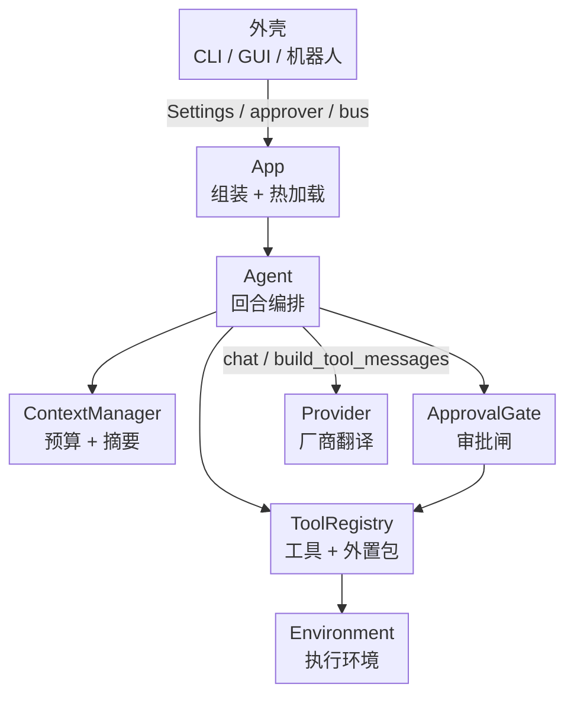
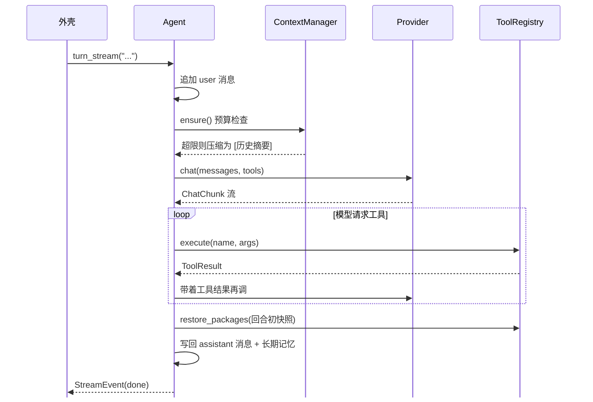

`yuki_kernel` 2972 行，84 个测试，5.9 秒跑完。

它不携带身份，不读环境变量，不绑定厂商。给它一个 Provider、一组工具、一份 Settings，它就能跑一次完整对话回合；剩下的 UI、人格、进程生命周期归外壳。

## 分层



三层接口：`App` 管组装，`Agent` 管回合，`send_message` + `execute_tool_calls` + `continue_with_tools` 管手动控制。外壳挑一层用。

内核只对外承诺 `yuki_kernel/__init__.py` 导出的那批名字，内部模块不当契约。

## 一次回合

`turn_stream()` 是主循环。关键在工具闭环和回合末还原。



回合开始记一份 `active_packages` 快照。模型中途调了没加载的包的工具，注册表会就地加载；本回合结束一律还原到快照。上下文里不会残留上一个问题的工具和提示词。

工具闭环没有轮次上限。模型要多少轮给多少轮，直到它不再请求工具。这是有意的：硬编码上限会让长任务半途截断，代价是成本可能失控，得靠审批和沙箱兜，不能靠轮次。

`turn_stream()` 吐原始事件，不做渲染清洗，`<think>` 标签可能出现在事件里。只有写回 `session` 和长期记忆前才用 `TagFilter` 剥掉，且处理了标签跨 chunk 被切成两半的情况：

```python
for tag in THINK_TAGS:
    for size in range(len(tag) - 1, 0, -1):
        if combined.endswith(tag[:size]):
            return combined[:-size], combined[-size:], saw_tag
```

## Provider：唯一需要懂的接口

两个方法，都是必须实现的：

| 方法 | 职责 |
|---|---|
| `chat()` | 异步生成器，把厂商流翻译成 `ChatChunk` |
| `build_tool_messages()` | 把「工具调用 + 结果」翻回厂商消息格式 |

`ChatChunk` 只有四个字段：`thinking`、`content`、`tool_calls`、`done`。HTTP、WebSocket、写死的字符串都能填进来，所以假 Provider 能完整测内核，测试不用联网。

OpenAI 兼容接口的流式 `tool_calls` 是按 `index` 分片下发的，名字和参数都会跨块拼。合并逻辑在 `skills/tools.py`：

```python
entry = merged.setdefault(call["index"], {"name": "", "arguments": ""})
if function.get("name"):
    entry["name"] += function["name"]
if args:
    entry["arguments"] += args
```

拼完的参数是字符串，`json.loads` 失败就退成 `{}`——宁可让模型收到空参数的错误结果，也不在解析层抛异常中断回合。

`register_provider()` 收的是类，不是实例。注册那一刻不创建任何对象，`create_provider()` 时才 `MyProvider(model, settings)`。传实例会让所有 Agent 共享同一个客户端，而且注册时还不知道 model。

一个容易踩的点：`Agent` 的 `provider` 参数默认 `"openai"`，不读 `settings.provider`。直接构造 Agent 时必须显式传，只有 `App` 会替你传。

## 工具包：目录 + manifest

外置包是带 `manifest.json` 的目录，声明工具和提示词。工具的执行入口两种：

- `python`：`module` + `handler`（+ 可选 `method`，handler 是类时用）
- `command`：命令数组，`{python}` 占位符会替换成环境里的解释器路径

python 入口不在内核进程里 `exec`。子进程跑一段引导脚本，参数走 stdin 的 JSON：

```python
command = [
    self.environment.python_path, "-c", _PY_BOOTSTRAP,
    str(module_path), handler, entry.get("method", "run"),
]
payload = json.dumps(arguments, ensure_ascii=False)
```

好处是不污染内核解释器，也不会因为一个包里的 `import` 让整个进程崩掉。子进程内任何异常都被包成 `{"type": "error", ...}` 打到 stdout，调用方拿到的永远是稳定格式的文本。

四个元工具常驻：`list_packages`、`load_package`、`unload_package`、`search_memory`。加载包时做名字冲突检查，工具名或提示词名撞了就拒绝加载，而不是静默覆盖。

## 执行环境与沙箱

`Environment` 一个对象承载两面：

| 面 | 内容 |
|---|---|
| 隔离面 `run()` | 在什么 OS 隔离下跑（降权、资源阀、命令白名单），委托 `Sandbox` |
| 运行面 `python_path` / `base_env` | 用哪个解释器、基础环境变量（venv 的 PATH / PYTHONPATH） |

内置工具和外置包工具走同一个环境，但喂进去的东西不同：

```python
if self._is_builtin(tool):
    env = {**self.environment.base_env, **os.environ}
    cwd = Path.cwd()
else:
    env = dict(self.environment.base_env) if self.environment.base_env else None
    cwd = Path(tool["package_dir"])
```

内置工具是内核自带的、可信的，继承宿主环境；外置包只拿到 `base_env`，宿主的 `HOME`、各种 token 不会泄漏给第三方代码。

`BasicSandbox` 纯标准库实现，靠 `preexec_fn` 在 fork 之后、exec 之前动手：

```python
os.setgid(gid); os.setuid(uid)                      # 先组后用户
resource.setrlimit(resource.RLIMIT_CPU, (10, 10))   # 默认 10 秒 CPU
resource.setrlimit(resource.RLIMIT_AS, (256MB,))    # 地址空间
resource.setrlimit(resource.RLIMIT_FSIZE, (10MB,))  # 单文件写入
```

说清它的边界：`setuid` 到别的 uid 只有 root 能成功，普通用户下会静默失败（代码用 `suppress` 吞了 `OSError`）。它降低的是「工具能干什么」的上限，不是隔离。真要强隔离，把内核整个跑进容器 / Seatbelt / Landlock，或者实现一个 `Sandbox` 注入进去。

## 审批

两个条件命中任一就走审批：`entry.type == "command"`，或工具声明了 `requires_approval`。内置工具里 `write_file`、`append_file`、`create_directory` 都标了。

审批结果是四个语义：

| 回答 | 效果 |
|---|---|
| `y` | 本次放行 |
| `ya` | 本会话放行 |
| `y 5` | 本会话放行 5 分钟 |
| 其它 | 拒绝，模型收到「用户拒绝执行」 |

放行记录存在 `Session.approved_tools`，值是过期时间戳，`ya` 存 `float("inf")`。会话一换就没了，不跨会话记住授权。

审批和沙箱不是一回事。审批是「放不放行」，沙箱是「放行了能干到哪」。两者叠加，缺一个都算裸奔。

## 上下文预算

估算不引入 tokenizer，直接按字符算：CJK 记 1 字符 ≈ 1 token，其余按 4 字符 ≈ 1 token，每条消息再加 4 的开销。

```python
cjk = len(_CJK_RE.findall(text))
latin = len(text) - cjk
return cjk + math.ceil(latin / 4)
```

超预算时最多修 3 轮：保留最近 `keep_recent_messages` 条，把 `memory[1:len-keep]` 交给模型压成一条 `[历史摘要]` system 消息。摘要请求走的是同一条带重试的 `chat` 通道，失败（`ProviderError` / 连接 / 超时 / OSError）就退化成丢掉最早的一条 user 或 assistant 消息。

摘要同时写进长期记忆，理由是压缩后原文就没了，但「上个小时说过什么」以后可能还要查。

副作用要提前知道：摘要调用本身也算一次模型调用，上下文吃紧时会额外花钱；`len/4` 的估法对英文密集内容和函数调用 JSON 都偏低。

## 两层记忆

短期是 `Session.messages`，纯内存。`SessionStore.save()` 才落盘，格式是每行一条 JSON 的 JSONL，再往 SQLite 写一行索引（`session_id / name / created_at / updated_at`）。列表按 `updated_at` 倒序，正文不进 SQLite，避免大字段拖慢查询。

长期记忆是另一张表，按 `namespace` 隔离，多个机器人能共用一个内核。检索是 SQL `LIKE`：英文按词切，中文按双字窗口切，所有词 `OR` 起来。

```python
terms.extend(cjk[i : i + 2] for i in range(len(cjk) - 1))
```

不是向量检索。双字窗口召回率够用、零依赖、可解释，代价是同义改写搜不到。要语义检索就把 `memory_searcher` 换成自己的实现——注册表只认一个 `(query) -> str` 的回调。

## 事件与中间件

两者都在 `_emit()` 里过一遍，职责不同：

- `EventBus`：只广播，不参与控制流，用来打日志、做观测。
- `Middleware`：`before` 能改事件、能 `event.context["abort"] = True` 中止；`after` 只能收尾。

能 abort 的只有 `user_message` 和 `tool_call` 两个点——回合开头和每次工具执行前，正好是外壳需要拦下的两处。

## 错误与重试

只有瞬时错误重试：`ProviderError`、`ConnectionError`、`TimeoutError`、`OSError`，以及厂商 SDK 抛的 `APIStatusError` 且 `status_code >= 500`。4xx 不重试，重试也没用。

退避 `retry_base * 2**attempt`，默认 0.5s 起步、3 次封顶。

工具异常不进这层。工具抛什么都被转成 `工具执行失败：...` 文本回喂模型，让模型自己决定换个参数再试还是放弃。调用方永远收不到工具异常。

## 几处取舍

**无轮次上限**。长任务能跑完，但一个跑飞的循环会持续烧钱。缓解手段是审批 + 沙箱 + 外壳侧的回合超时，内核自己不管。

**关键词检索代替向量检索**。零依赖、无索引构建、结果可解释；换来的是搜不到同义表达。真需要就换 searcher。

**上下文估算按字符**。省掉 tokenizer 依赖和版本对齐，误差在可控范围，但别指望它精确——`max_context_tokens` 要留余量。

**同步工具占线程**。除 `run_sleep` 走 `asyncio.sleep` 外，工具都在 `asyncio.to_thread` 里同步执行。并发多的时候线程池是瓶颈，这是为「工具就是普通 Python 函数」这个简单契约付的代价。

**包信任是前提**。沙箱只限能干什么，不判断包该不该加载。装第三方包之前自己看代码，这一条没有技术手段替代。

## 嵌进来

最小可跑的例子，不联网：

```python
class EchoProvider(Provider):
    def build_tool_messages(self, tool_calls, results):
        return []

    async def chat(self, messages, tools=None, **kwargs):
        yield ChatChunk(content="你好，我是回声。")


settings = Settings(provider="echo", model="echo")
agent = Agent(
    settings.model,
    ToolRegistry(),
    settings,
    provider=EchoProvider(settings.model, settings),
)
print((await agent.turn("你好")).content)
```

真实使用时换成 `App`，它会扫描包目录、预加载指定包、把 `MemoryStore.search_text` 接到 `search_memory` 工具上，并支持 `reload(new_settings)` 热换配置（重建 registry 和 agent、保留当前会话、关掉旧 Provider）。

仓库：<https://github.com/cixiy1/Yuki>，内核在 `kernel/`，`example/` 是一个完整外壳。
